# Hiểu bài toán và pipeline lựa chọn đặc trưng cho phát hiện tấn công mạng

Tài liệu này giải thích báo cáo **Phát hiện tấn công mạng dựa trên mô hình Feature Selection nâng cao** theo cách dành cho người mới học. Nguồn chính là [báo cáo Word](../BaoCao_FeatureSelection_NIDS.docx), đặc biệt Chương 1–3 và phụ lục. Các bảng kết quả dưới đây lấy từ báo cáo, không phải kết quả chạy lại. Phần đối chiếu mã nguồn ghi nhận trạng thái các script tại thời điểm viết tài liệu ngày 16/11/2026.


Tài liệu có **34 hình**, gồm 14 sơ đồ và tranh minh họa khái niệm cùng 20 biểu đồ dữ liệu. Các hình được đặt ngay tại phần giải thích tương ứng. Sơ đồ thể hiện quy trình hoặc ví dụ; biểu đồ kết quả lấy số liệu đã có trong báo cáo, không phải thực nghiệm chạy mới. Biểu đồ F1 dùng thang 0–1; các ô màu có ghi số để đọc chênh lệch nhỏ.

**Mục lục:** [Bài toán](#1-bài-toán-là-gì-và-giải-quyết-tổng-quan-ra-sao) · [Khái niệm](#2-các-khái-niệm-cần-hiểu-trước-khi-đọc-pipeline) · [Độ đo](#3-các-độ-đo-và-cách-đọc-con-số) · [Dữ liệu](#4-dữ-liệu-sử-dụng) · [EDA](#5-phân-tích-khám-phá-dữ-liệu-trước-khi-huấn-luyện) · [Tiền xử lý](#6-tiền-xử-lý-dữ-liệu-từng-bước) · [Thuật toán](#7-các-phương-pháp-chọn-đặc-trưng-hoạt-động-thế-nào) · [Kết quả tổng quan](#8-kết-quả-tổng-quan-nên-nhớ-trước) · [Kết quả chi tiết](#9-kết-quả-chi-tiết-và-cách-diễn-giải) · [Đối chiếu mã](#11-các-điểm-cần-phân-biệt-giữa-báo-cáo-nguyên-tắc-và-mã-hiện-tại)

## 1. Bài toán là gì và giải quyết tổng quan ra sao

### 1.1. Ta muốn máy tính làm gì


*Gói tin được gom thành luồng, trích đặc trưng, chọn cột rồi đưa vào bộ phân loại. Hai nhánh cuối là hai chế độ nhãn thay thế.*


Giả sử một hệ thống mạng ghi lại nhiều kết nối. Mỗi kết nối được mô tả bằng các con số: kéo dài bao lâu, có bao nhiêu gói tin, gói tin dài bao nhiêu, gửi đến cổng nào, khoảng cách giữa các gói ra sao. Máy tính cần dựa vào các thông tin đó để xác định kết nối bình thường hay tấn công.

Đây là bài toán **phân loại có giám sát**: trong dữ liệu huấn luyện, ta đã biết đáp án của từng dòng. Máy học mối quan hệ giữa thông tin đầu vào và đáp án, rồi dự đoán cho các dòng chưa dùng để huấn luyện.

Đề tài có thêm một câu hỏi nghiên cứu: **có thể chỉ dùng một phần nhỏ các thông tin đầu vào mà vẫn phân loại tốt và huấn luyện nhanh hơn không?** Việc tìm phần nhỏ đó gọi là lựa chọn đặc trưng, hay Feature Selection, viết tắt FS.

Ví dụ, CICIDS2017 trong báo cáo có 52 đặc trưng đầu vào. Thay vì luôn dùng cả 52 cột, GA chọn 5 cột cho bài toán nhị phân. Cần kiểm tra xem mô hình dùng 5 cột này mất bao nhiêu chất lượng và tiết kiệm bao nhiêu thời gian so với mô hình dùng đủ 52 cột.

**Vì sao phải chọn đặc trưng khi đã có thể dùng tất cả cột?** Thu thập và xử lý nhiều cột làm tăng chi phí; một số cột gần trùng thông tin hoặc chỉ đúng trong môi trường thu thập. Một tập nhỏ có thể dễ triển khai và diễn giải hơn. Tuy vậy, bỏ cột cũng có thể bỏ mất tín hiệu của lớp hiếm. Vì thế đề tài phải đo cả chất lượng lẫn chi phí, không chỉ tìm tập ít cột nhất.

### 1.2. Đầu vào và đầu ra của toàn bộ hệ thống

**Đầu vào** là các tệp CSV đã có đặc trưng thống kê của luồng và nhãn đúng. Báo cáo bắt đầu từ dữ liệu dạng bảng; phần trực tiếp bắt gói tin và trích đặc trưng từ mạng không phải phần được triển khai chính ở đây.

**Đầu ra** gồm danh sách các cột được giữ, số cột còn lại, chất lượng phân loại trên test, thời gian tìm kiếm và thời gian huấn luyện hoặc suy luận được ghi nhận. Các biểu đồ EDA, đường hội tụ và thí nghiệm bỏ/thêm đặc trưng giúp giải thích độ tin cậy của kết quả.

**Vì sao lưu cả danh sách cột và các độ đo?** Chỉ ghi “F1 = 0,99” chưa cho biết mô hình nhận những thông tin nào hoặc có thể tái sử dụng ra sao. Danh sách cột cho phép tạo đúng đầu vào khi đánh giá lại; các độ đo và thời gian cho biết lợi ích và tổn thất. Mô hình học với thứ tự cột nào thì dữ liệu dự đoán phải được sắp đúng thứ tự tương ứng.

### 1.3. Cách giải quyết tổng quan


*Minh họa pipeline bằng các thao tác trực quan: thu thập bảng dữ liệu, kiểm tra, chia tập, tiền xử lý, chọn cột và đánh giá. Hình mô tả quy trình nên áp dụng; các khác biệt của mã hiện tại được giải thích tại Mục 11.*


Các nhánh FS là các phương án thay thế để so sánh. Không phải chạy MI rồi GA rồi PSO rồi cả hai Hybrid nối tiếp nhau. Chỉ riêng các phương pháp lai mới có các bước nối tiếp bên trong.

**Kết luận tổng quan của báo cáo:** trên CICIDS2017 và UNSW-NB15, có thể giảm nhiều đặc trưng mà vẫn giữ chất lượng tương đối tốt. Trên CICDDoS2019, kết quả phụ thuộc mạnh vào dữ liệu, cặp đặc trưng đặc biệt và bộ phân loại. Không có một phương pháp tốt nhất cho mọi trường hợp.

**Vì sao kiểm tra dữ liệu trước rồi mới so sánh thuật toán?** Nếu nhãn sai hoặc một cột tiết lộ đáp án theo cách thu thập, mọi phương pháp đều đang được so trên một bài toán sai lệch. Tốn thêm công kiểm tra đầu vào giúp tránh tối ưu một mô hình chỉ giỏi tận dụng lỗi dữ liệu. Phép so sánh cuối còn cần cùng cách chia dữ liệu và cùng bộ phân loại để giảm các nguyên nhân gây chênh lệch ngoài phương pháp FS.

## 2. Các khái niệm cần hiểu trước khi đọc pipeline

### 2.1. Gói tin, luồng và NIDS

**Gói tin** là một đơn vị dữ liệu truyền qua mạng. Một lần trao đổi thường gồm nhiều gói tin. **Luồng**, hay flow, gom các gói có chung thông tin kết nối theo quy tắc của công cụ thu thập, thường liên quan đến địa chỉ nguồn, địa chỉ đích, cổng nguồn, cổng đích và giao thức.

**NIDS**, Network Intrusion Detection System, là hệ thống phát hiện xâm nhập mạng. Trong báo cáo này, mô hình nhận thông tin thống kê của một luồng rồi phân loại. Phát hiện một luồng đáng ngờ chưa đồng nghĩa với tự động ngăn chặn cuộc tấn công.

Một số kiểu tấn công xuất hiện trong báo cáo:

| Loại | Cách hiểu ban đầu |
|:---|:---|
| DoS | Gây quá tải hoặc làm cạn tài nguyên để dịch vụ khó đáp ứng người dùng |
| DDoS | Tấn công từ chối dịch vụ từ nhiều nguồn |
| Port Scanning | Dò các cổng để tìm dịch vụ đang hoạt động |
| Brute Force | Thử nhiều thông tin đăng nhập để tìm mật khẩu đúng |
| Web Attacks | Các tấn công vào ứng dụng web |
| Bots | Lưu lượng liên quan đến máy hoặc chương trình bị điều khiển tự động |

**Vì sao dùng luồng thay cho từng gói riêng lẻ?** Một gói có thể chưa đủ ngữ cảnh: phải xem nhiều gói mới biết tốc độ gửi, độ biến động độ dài hoặc nhịp thời gian của kết nối. Gom thành luồng cho phép tính các thống kê đó và tạo một dòng đầu vào có số cột cố định. Đổi lại, có thể phải chờ đủ gói hoặc hết khoảng quan sát mới tạo được đặc trưng, nên tốc độ dự đoán trên bảng chưa phản ánh toàn bộ độ trễ phát hiện thực tế.

### 2.2. Dòng dữ liệu, đặc trưng và nhãn

Mỗi **dòng** là một mẫu quan sát. Mỗi **đặc trưng** là một cột đầu vào. **Nhãn** là đáp án cần dự đoán. Bảng dưới đây chỉ là ví dụ minh họa, không lấy từ bộ dữ liệu thực nghiệm:

| Mẫu | Thời lượng | Số gói | Cổng đích | Nhãn |
|:---|---:|---:|---:|:---|
| A | 0,8 | 12 | 443 | Normal |
| B | 0,1 | 900 | 80 | Attack |

Ta ký hiệu bảng đầu vào là `X`, cột đáp án là `y`. Không đưa cột nhãn hoặc một bản sao của nhãn vào `X`, vì khi đó mô hình có thể nhìn trực tiếp đáp án.

Các đặc trưng thường gặp gồm `Flow Duration` (thời lượng luồng), `Packet Length Mean` (độ dài gói trung bình), `Packet Length Std` (mức biến động độ dài), `IAT` (thời gian giữa các gói), `Destination Port` (cổng đích), `SYN Flag Count` và `URG Flag Count` (số lần xuất hiện các cờ TCP tương ứng). Đơn vị và cách tính cụ thể phải theo định nghĩa của bộ dữ liệu.

**Vì sao tách X và y?** X là thông tin có sẵn khi cần dự đoán; y là đáp án chỉ biết trong dữ liệu đã gán nhãn. Cho y vào X giống như để đáp án trong đề thi. Chẳng hạn khi dùng `label` làm đáp án nhị phân của UNSW, cột `attack_cat` cũng phải được loại khỏi đầu vào vì tên nhóm tấn công có thể tiết lộ trực tiếp Normal hay Attack.

### 2.3. Nhị phân và đa lớp

**Nhị phân** chỉ có hai đáp án: Normal và Attack. DoS, DDoS hay Bots đều được gom thành Attack.

**Đa lớp** giữ các nhóm chi tiết, chẳng hạn Normal, DoS, DDoS, Bots. Bài toán khó hơn vì mô hình phải phân biệt cả những loại tấn công có biểu hiện gần nhau, và một số lớp có rất ít mẫu.

Một mô hình làm tốt nhị phân chưa chắc làm tốt đa lớp. Nhận biết “đây là tấn công” thường dễ hơn gọi đúng loại tấn công.

**Vì sao đánh giá cả hai chế độ?** Nhị phân phục vụ câu hỏi “có cần cảnh báo không?”, còn đa lớp cho biết “cảnh báo thuộc nhóm nào?”. Gom thành Attack giúp có nhiều mẫu cho một nhãn chung nhưng che đi việc mô hình có nhận ra từng loại tấn công hay không. Vì vậy không dùng F1 nhị phân cao để khẳng định mọi nhóm tấn công đều được nhận biết tốt.

### 2.4. Train, validation và test


*Chỉ train tham gia tìm tập cột; test chỉ mở ở đánh giá cuối. Các điểm số ví dụ trong tranh là giả định, không phải kết quả báo cáo.*


**Train** dùng để học. **Validation** dùng để so sánh cấu hình hoặc tập đặc trưng trong quá trình tìm kiếm. **Test** dùng để đánh giá sau khi đã chốt lựa chọn.

Trong wrapper của báo cáo, lấy một phần từ train rồi chia 70% để huấn luyện mô hình thử nghiệm và 30% để tính fitness. Sau khi tìm được tập cột, huấn luyện một mô hình cuối trên toàn bộ train với các cột đó.


Test phải được giữ độc lập. Nếu liên tục chọn phương pháp, chỉnh trọng số hoặc loại cột dựa trên test, test dần trở thành một phần của quá trình phát triển. Khi đó cần một tập kiểm tra độc lập mới để xác nhận kết luận.

**Vì sao phải có validation bên trong train?** Nếu GA thử hàng trăm tập cột rồi chọn tập đạt điểm cao nhất ngay trên dữ liệu đã dùng huấn luyện, nó dễ chọn tập giúp cây ghi nhớ dữ liệu. Validation buộc mỗi ứng viên dự đoán các dòng chưa dùng để fit cây của ứng viên đó. Tuy nhiên, tìm kiếm nhiều lần trên cùng validation cũng có thể làm quá khớp validation; test riêng là lớp kiểm tra tiếp theo.

**Vì sao huấn luyện lại trên toàn bộ train sau tìm kiếm?** Khi đã chốt cột, ta không cần giữ riêng validation cho mục đích chọn cột nữa, nên có thể dùng lại các dòng đó để mô hình cuối học từ nhiều dữ liệu hơn. Bước này chỉ gộp các phần của train; test vẫn độc lập.

### 2.5. Mất cân bằng, phân tầng và rò rỉ dữ liệu

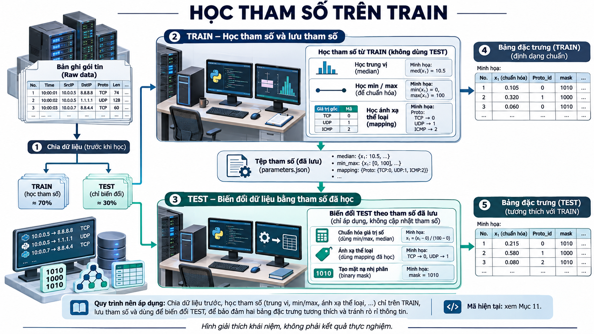

*Tham số được học trên train, lưu lại và áp dụng cho test. Tỷ lệ chia trong tranh chỉ minh họa, không phải tỷ lệ cố định của các bộ dữ liệu. Việc chọn cột được giải thích riêng ở Mục 7.*


**Mất cân bằng** nghĩa là số mẫu các lớp khác nhau nhiều. Nếu 90% là Attack, mô hình luôn đoán Attack đã có Accuracy 90%, dù không nhận biết được Normal.

**Chia phân tầng**, `stratify=y`, cố giữ tỷ lệ các lớp ở các phần dữ liệu. Với lớp rất hiếm, phải thiết kế kích thước mẫu và cách chia để lớp đó có đủ đại diện; phân tầng không tự tạo thêm dữ liệu cho lớp chỉ có một mẫu.

**Rò rỉ dữ liệu** xảy ra khi quá trình học nhận thông tin mà đáng ra chưa được biết. Ví dụ tính min/max trên cả train và test trước khi đánh giá. Quy tắc đúng là chia dữ liệu trước, học mọi tham số tiền xử lý trên train rồi áp dụng cho test. Nếu đánh giá nghiêm ngặt trên validation, các phép biến đổi cần được học trong phần train của từng lần chia validation nữa.

**Min/max ở đây được tính để chuẩn hóa giá trị của từng cột bằng MinMaxScaler.** `min` là giá trị nhỏ nhất và `max` là giá trị lớn nhất của một cột trong train. Mỗi cột có cặp min/max riêng; không lấy một cặp chung cho cả bảng và không tính trên cột nhãn.

Trong dữ liệu mạng, các cột có đơn vị và độ lớn rất khác nhau. Một cột có thể là thời lượng tính bằng microsecond với giá trị hàng triệu; cột khác là số cờ SYN chỉ từ 0 đến vài đơn vị. Số lớn hơn không có nghĩa đặc trưng quan trọng hơn. Chuẩn hóa đổi thang biểu diễn để các cột có khoảng giá trị tương đương, hữu ích với các thuật toán dựa vào khoảng cách hoặc nhạy với thang đo.

Công thức cho một cột không hằng:

`x_chuẩn_hóa = (x − min_train) / (max_train − min_train)`.

Ví dụ minh họa: cột thời lượng trong train có các giá trị 10, 30, 50. Ta học được `min_train = 10`, `max_train = 50`:

| Dữ liệu | Giá trị gốc | Phép tính bằng tham số train | Giá trị sau chuẩn hóa |
|:---|---:|:---|---:|
| Train | 10 | (10 − 10) / 40 | 0,00 |
| Train | 30 | (30 − 10) / 40 | 0,50 |
| Train | 50 | (50 − 10) / 40 | 1,00 |
| Test | 40 | (40 − 10) / 40 | 0,75 |
| Test | 70 | (70 − 10) / 40 | 1,50 |

Giá trị test bằng 70 trở thành 1,50 là bình thường khi không bật cắt ngưỡng: nó lớn hơn cực đại đã gặp trong train. Không cần tính lại min/max test để ép nó về [0, 1]. Cột hằng có `max = min` cần được xử lý riêng để tránh chia cho 0; pipeline có bước loại các cột gần hằng trên train.

**Vì sao chỉ tính trên train?** Khi triển khai thật, ta chưa biết các luồng mạng tương lai lớn hoặc nhỏ đến đâu. Ta chỉ có thể lưu tham số từ dữ liệu đã học và dùng chúng cho các luồng mới. Test phải mô phỏng tình huống đó. Nếu dùng cả test để biết trước cực trị, cách biểu diễn train đã phụ thuộc thông tin từ dữ liệu đáng ra chưa được thấy. Đây là rò rỉ dù chưa dùng nhãn test.

Ví dụ, nếu nhìn thấy giá trị test 70 rồi đổi cực đại từ 50 thành 70, giá trị train 30 sẽ được đổi thành `(30 − 10) / (70 − 10) ≈ 0,3333`, thay vì 0,50. Như vậy chính dữ liệu train cũng đã được biến đổi dựa vào test. Nếu tính min/max riêng cho từng tập thì lại mất sự nhất quán: cùng một giá trị gốc có thể được biểu diễn bằng các số khác nhau giữa train và test.

Hai thao tác thường gặp trong code là `fit` và `transform`: **fit** học và lưu min/max từ train; **transform** dùng min/max đã lưu để đổi giá trị. Trình tự là `fit_transform(X_train)` rồi `transform(X_test)`, không gọi `fit_transform(X_test)`.

**Trong báo cáo này, chuẩn hóa có bắt buộc với DT, RF và XGBoost không?** Các mô hình cây chia theo ngưỡng trên từng cột, nên thường ít nhạy với thang đo và không bắt buộc phải MinMax như các phương pháp dựa vào khoảng cách. Phép đổi tuyến tính tăng giữ thứ tự các giá trị; chẳng hạn ngưỡng gốc 30 tương ứng ngưỡng chuẩn hóa 0,50 trong ví dụ. Pipeline dùng MinMax để thống nhất cách biểu diễn, nhưng không nên kết luận rằng riêng bước này chắc chắn làm F1 tăng hoặc rằng cột có số lớn sẽ lấn át các cột khác trong mô hình cây.

Chuẩn hóa cũng không giải quyết mất cân bằng nhãn: nó đổi giá trị trong cột, không đổi số lượng mẫu Normal và Attack. Mất cân bằng, phân tầng và chuẩn hóa là các vấn đề khác nhau trong pipeline.

### 2.6. Quá khớp và lệch phân phối

**Quá khớp** là học quá sát các chi tiết riêng của dữ liệu huấn luyện, nên gặp dữ liệu mới dự đoán kém. Giảm đặc trưng có thể giúp nhưng cũng có thể làm mất tín hiệu cần thiết.

**Lệch phân phối train–test** nghĩa là dữ liệu lúc kiểm tra khác dữ liệu lúc học. CICDDoS2019 là ví dụ rõ: test chứa những loại tấn công không có ở train. Vì vậy tập cột tốt trên validation tách từ train chưa chắc tốt trên test.

**Vì sao chia ngẫu nhiên chưa đủ để mô phỏng mọi tình huống thực tế?** Khi chia ngẫu nhiên, các dòng trong train và test có thể đến từ cùng đợt thu thập và cùng cấu hình mạng. Mô hình dễ gặp lại các mẫu rất giống nhau. Chia theo thời gian, máy hoặc nhóm tấn công đặt câu hỏi khó hơn: mô hình có dùng được ở điều kiện mới hay không? Đây là các thiết kế đánh giá khác nhau, không nên so điểm như thể chúng cùng mức độ khó.

## 3. Các độ đo và cách đọc con số

### 3.1. Ma trận nhầm lẫn


*Bốn tình huống TP, FN, FP, TN được minh họa bằng lưu lượng mạng. Hình giải thích kết quả phân loại, không mô tả cơ chế tự động chặn kết nối.*


*Đánh giá luồng mạng trên test, đọc TP/FP/TN/FN, đổi bộ phân loại trên cùng tập cột và ablation. Các số ví dụ trong tranh không phải kết quả thực nghiệm; công thức và số liệu chính xác nằm trong phần chữ và các biểu đồ kết quả.*


Quy ước Attack là lớp dương cho các công thức nhị phân dưới đây:

| Thực tế | Dự đoán Attack | Dự đoán Normal |
|:---|:---|:---|
| Attack | TP: phát hiện đúng tấn công | FN: bỏ sót tấn công |
| Normal | FP: cảnh báo nhầm | TN: nhận đúng bình thường |

Các chỉ số:

```text
Accuracy  = (TP + TN) / (TP + TN + FP + FN)
Precision = TP / (TP + FP)
Recall    = TP / (TP + FN)
F1        = 2 × Precision × Recall / (Precision + Recall)
FAR/FPR   = FP / (FP + TN)
```

Precision trả lời “trong các cảnh báo tấn công, bao nhiêu là đúng?”. Recall, cũng gọi là Detection Rate khi xét lớp Attack, trả lời “trong các tấn công thực, phát hiện được bao nhiêu?”. FAR/FPR đo tỷ lệ lưu lượng bình thường bị báo nhầm. Cần kiểm tra lớp dương và cách lấy trung bình trước khi gọi một giá trị Recall trong JSON là Detection Rate.

**Vì sao cần xem cả Precision và Recall?** Một mô hình báo Attack cho mọi luồng có thể bắt được mọi tấn công, tức Recall cao, nhưng tạo rất nhiều cảnh báo nhầm. Mô hình chỉ cảnh báo những trường hợp quá rõ có thể có Precision cao nhưng bỏ sót nhiều tấn công. Ma trận nhầm lẫn chỉ ra lỗi nằm ở phía nào; F1 giúp phối hợp Precision và Recall nhưng không thay thế hoàn toàn việc xem FN và FP.

### 3.2. Vì sao dùng F1-macro

Tính F1 cho từng lớp rồi lấy trung bình đều:

`F1-macro = (F1_lớp_1 + ... + F1_lớp_C) / C`.

Mỗi lớp có cùng trọng số, kể cả lớp hiếm. **F1-weighted** cũng lấy trung bình F1 từng lớp nhưng nhân trọng số theo số mẫu, nên lớp lớn ảnh hưởng nhiều hơn. Báo cáo chủ yếu dùng F1-macro để nhìn rõ khả năng nhận biết các lớp ít mẫu.

Ví dụ minh họa: ba lớp có F1 lần lượt là 0,99; 0,90; 0,10 thì F1-macro chỉ khoảng 0,6633. Lớp cuối đang được nhận biết rất kém, dù lớp phổ biến có thể rất tốt.

F1 `0,9975` tương đương `99,75%`. Tăng từ `0,8553` lên `0,8658` là tăng **1,05 điểm phần trăm**, không phải tăng 10,5 điểm.

**Vì sao không chỉ dùng Accuracy?** Giả sử có 990 Normal và 10 Attack. Mô hình luôn đoán Normal đúng 990/1.000 dòng, Accuracy 99%, nhưng Recall của Attack bằng 0. F1-macro dành trọng số ngang nhau cho hai lớp, nên thể hiện nhược điểm này rõ hơn. Với nhiều lớp, vẫn cần xem F1 từng lớp vì một giá trị trung bình chưa chỉ ra tên lớp đang bị bỏ sót.

### 3.3. Số chiều và thời gian

Gọi `D` là số cột đầu vào sau tiền xử lý, `k` là số cột giữ lại:

`Tỷ lệ giảm chiều = (D − k) / D × 100%`.

Ví dụ 52 xuống 5 là giảm khoảng 90,38%. Giảm chiều không phải xóa 90% số dòng và cũng không có nghĩa kích thước tệp hay mọi loại thời gian đều giảm đúng tỷ lệ đó.

Cần phân biệt **T_FS** (tìm đặc trưng), **T_train** (huấn luyện mô hình cuối) và **T_inference** (dự đoán). Bảng chính của báo cáo đưa thời gian huấn luyện, không phải tổng chi phí pipeline. Wrapper có thể tốn nhiều phút tìm kiếm để đổi lấy một mô hình huấn luyện nhanh hơn. Báo cáo chưa cung cấp đầy đủ DR, FAR, F1-weighted và thời gian suy luận cho từng phương án, nên tài liệu này không tự bổ sung các con số đó.

**Vì sao tách ba loại thời gian?** Một phương pháp có thể mất 30 phút tìm cột nhưng mô hình cuối chỉ mất 1 giây huấn luyện. Nếu chỉ chạy một lần, chi phí tìm kiếm là đáng kể; nếu dùng mô hình để dự đoán nhiều lần, chi phí suy luận có thể quan trọng hơn. Cần chọn cách so phù hợp với tình huống sử dụng, và phải đo thực tế thay vì suy ra rằng giảm 80% cột chắc chắn nhanh hơn 80%.

## 4. Dữ liệu sử dụng

### 4.1. Tổng quan ba bộ dữ liệu

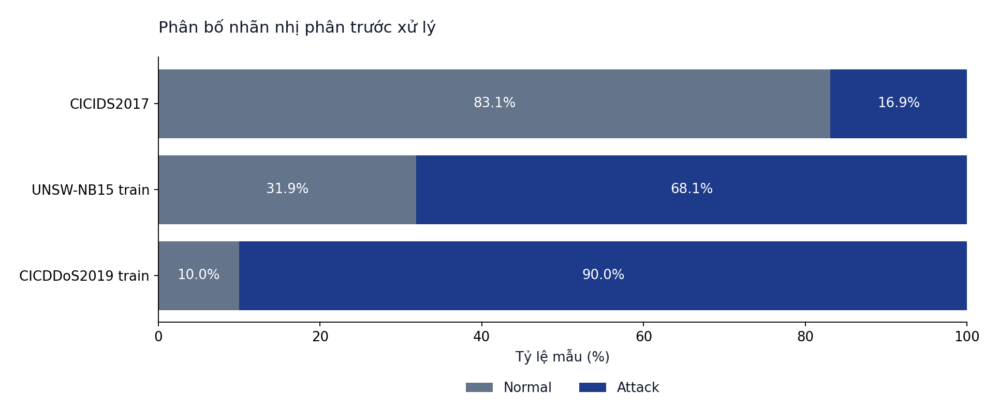

*Phân bố nhị phân: CICIDS2017 nhiều Normal, CICDDoS2019 nhiều Attack. Tỷ lệ làm tròn theo Bảng 3.2.*

| Bộ dữ liệu | Train sau xử lý | Test | Đặc trưng đầu vào D | Nhãn gốc | Cách chia |
|:---|---:|---:|---:|:---|:---|
| CICIDS2017 | 2.016.472 | 504.118 | 52 | 7 lớp | Một tệp, phân tầng 80/20 |
| UNSW-NB15 | 175.341 | 82.332 | 42 | 10 lớp | Train/test có sẵn |
| CICDDoS2019 | 562.649 | 561.000 | 67 | 8 lớp train, 11 lớp test | Các tệp theo loại tấn công |

Số đặc trưng này là của phiên bản và quy trình trong báo cáo. Không áp dụng mặc định cho mọi bản tải về có cùng tên bộ dữ liệu. NSL-KDD có trong phạm vi dự án nhưng không nằm trong ba bộ thực nghiệm chính của báo cáo Word này.

**Vì sao thử trên nhiều bộ dữ liệu?** Một thuật toán có thể phù hợp với kiểu lưu lượng, nhãn hoặc cách chia của một bộ nhưng kém ở bộ khác. Ba bộ khác nhau giúp quan sát giới hạn đó. Không gộp điểm của chúng thành một cuộc thi đơn giản: số lớp, độ mất cân bằng và mức khác nhau giữa train/test đều làm thay đổi độ khó.

### 4.2. CICIDS2017

Báo cáo dùng bản Kaggle “Cleaned & Preprocessed”, có 2.520.751 dòng ban đầu, 52 đặc trưng số và nhãn `Attack Type`. Bảy lớp là Normal Traffic, DoS, DDoS, Port Scanning, Brute Force, Web Attacks và Bots.

Tỷ lệ nhị phân khoảng 83,1% Normal và 16,9% Attack. Chia ngẫu nhiên giúp các phần dữ liệu tương đối giống nhau, nhưng kết quả đó chưa chứng minh mô hình hoạt động tương đương khi chuyển sang ngày thu thập hoặc hệ thống mạng khác.

Tổng train và test trong bảng là 2.520.590, ít hơn dữ liệu đầu vào 161 dòng. Đây là hai giai đoạn đếm khác nhau; không nên coi số mẫu EDA và số mẫu cuối là cùng một đại lượng.

**Vì sao phải ghi rõ phiên bản CICIDS2017?** Bản đã làm sạch có thể khác bản gốc về dòng, cột và cách gộp nhãn. Nếu chỉ ghi tên CICIDS2017, người chạy lại có thể tải một bản khác và không tái lập được kết quả. Cần lưu nguồn, phiên bản và các bước xử lý, thay vì xem mọi tệp mang cùng tên là tương đương.

### 4.3. UNSW-NB15

Hai tệp train và test có sẵn; mỗi tệp có 45 cột. Loại `id` và các cột nhãn còn 42 đặc trưng, gồm ba cột dạng phân loại `proto`, `service`, `state`.

Nhãn đa lớp gồm Normal và chín nhóm: Fuzzers, Analysis, Backdoors, DoS, Exploits, Generic, Reconnaissance, Shellcode, Worms. Train có khoảng 31,9% Normal và 68,1% Attack. Bài toán đa lớp khó hơn rõ rệt so với CICIDS2017 qua F1-macro.

**Vì sao giữ train/test có sẵn của UNSW?** Giữ phép chia giúp các phương pháp trong thí nghiệm dùng cùng điều kiện và tránh vô tình biến bài toán thành một phép chia dễ hơn. Các cột chữ cần được mã hóa vì mô hình nhận ma trận số. Nếu tự gộp rồi chia lại, kết quả trả lời một thiết kế thí nghiệm khác và phải được ghi rõ.

### 4.4. CICDDoS2019

Bản dùng trong báo cáo có 88 cột thô, gộp từ 7 tệp train và 10 tệp test. Train ban đầu có 569.650 dòng; sau xử lý còn 562.649. Test có 561.000 dòng. Dữ liệu train nhị phân khoảng 10% Normal và 90% Attack.

Sau loại định danh, 12 cột phương sai gần 0 và `Inbound`, còn 67 đặc trưng. DNS, NTP, SNMP, TFTP có ở test nhưng chưa có ở train; Portmap chỉ có ở train.

Với nhị phân, các loại tấn công mới vẫn thuộc nhãn Attack đã biết. Với đa lớp, mô hình chưa học tên các lớp mới, nên không thể kỳ vọng bộ phân loại có giám sát thông thường tự gọi đúng tên chúng. Đây là lý do cần đọc hai bài toán riêng biệt.

**Vì sao loại tấn công mới ảnh hưởng mạnh đến cách diễn giải?** Trong nhị phân, mô hình đã học nhãn Attack nên vẫn có cơ hội nhận biết hành vi chung của loại mới. Trong đa lớp, tên lớp mới chưa từng có trong dữ liệu học, nên mô hình phân loại thông thường chỉ có thể dự đoán trong các lớp đã học. Điểm thấp khi ấy không chỉ do tập đặc trưng yếu mà còn do giới hạn của thiết kế học có giám sát.

## 5. Phân tích khám phá dữ liệu trước khi huấn luyện

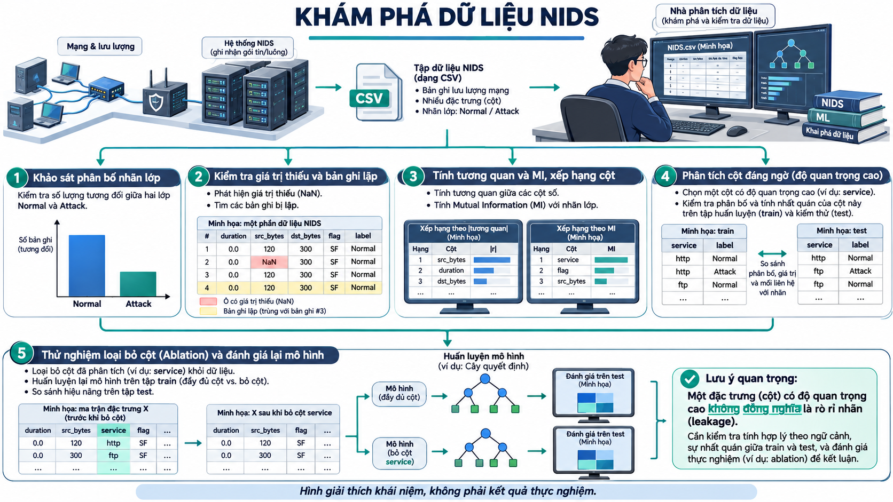

*EDA khảo sát nhãn, giá trị thiếu, dòng trùng và đặc trưng đáng ngờ. Mọi bảng số ví dụ trong tranh chỉ minh họa.*


EDA là bước xem dữ liệu có cấu trúc gì và có vấn đề gì. Đầu vào là bảng dữ liệu; đầu ra là thống kê, biểu đồ và các nghi vấn cần kiểm tra.

### 5.1. Kiểm tra kích thước, kiểu dữ liệu và nhãn

Đếm dòng, cột, giá trị thiếu, vô cực, dòng trùng và số mẫu từng nhãn. Kiểm tra sau khi đổi nhãn nhị phân có thật sự còn hai lớp hay không.

Báo cáo từng gặp lỗi: chương trình chỉ so khớp chính xác `normal` hoặc `benign`, trong khi nhãn là `Normal Traffic`. Tất cả các dòng bị đổi thành Attack. Khi ấy F1 và Accuracy đều 1,0000 vì chỉ còn một đáp án. Sau khi sửa nhận diện chuỗi con, baseline CICIDS2017 còn F1-macro 0,9975. Đây là lý do phải kiểm tra nhãn trước khi tin một kết quả rất cao.

**Vì sao kiểm tra kiểu dữ liệu và đếm từng nhãn?** Một cột số bị đọc thành chữ có thể không được xử lý như dự định; khoảng trắng trong nhãn có thể tạo thêm một lớp giả. Đếm nhãn trước và sau ánh xạ giúp phát hiện mất lớp hoặc gộp sai. Không kiểm tra bước này thì ngay cả F1 hoàn hảo cũng có thể chỉ là hậu quả của một lỗi gán nhãn như trường hợp CICIDS2017.

### 5.2. Tương quan giữa các cột

Hệ số tương quan `r` mô tả quan hệ tuyến tính; `|r|` gần 1 cho thấy hai cột biến thiên gần nhau. Báo cáo đếm các cặp có `|r| > 0,95`: CICIDS2017 có 23 cặp, UNSW có 13, CICDDoS2019 có 48.

Các cột như độ dài gói trung bình, độ lệch chuẩn và phương sai có thể chia sẻ thông tin. Giữ nhiều cột gần trùng thông tin làm tăng chi phí mà chưa chắc giúp phân loại. Tuy nhiên tương quan không phải phép thử đầy đủ cho mọi quan hệ phi tuyến.

**Vì sao xem các cặp tương quan cao?** Nếu hai cột biến đổi gần giống nhau, chúng có thể cung cấp thông tin dư thừa; đây là cơ hội giảm chiều. Tuy nhiên, không xóa máy móc mọi cột tương quan: hai cột gần giống trên đa số mẫu vẫn có thể khác ở những mẫu tấn công hiếm. Ngưỡng 0,95 là ngưỡng khảo sát trong báo cáo, không phải ranh giới tự nhiên giữa “có ích” và “vô ích”.

### 5.3. Mutual Information và entropy nhãn

**Entropy** diễn tả mức bất định của nhãn trước khi nhìn đặc trưng. **Mutual Information**, MI, diễn tả lượng thông tin về nhãn mà một đặc trưng cung cấp. MI cao nghĩa là cột đó giúp phân biệt nhãn tốt hơn theo cách đo này.

| Bộ dữ liệu | Cột MI cao nhất | MI | Entropy nhãn | MI/entropy | Phương sai giải thích bởi PCA 2 thành phần |
|:---|:---|---:|---:|---:|---:|
| CICIDS2017 | Average Packet Size | 0,3275 | 0,4498 | 72,8% | 82,2% |
| UNSW-NB15 | sbytes | 0,4436 | 0,6262 | 70,8% | 99,1% |
| CICDDoS2019 | Average Packet Size | 0,2551 | 0,3178 | 80,3% | 99,7% |

MI bằng 80,3% entropy không có nghĩa Accuracy là 80,3%. Đây là hai đại lượng khác nhau. Ngưỡng MI vượt 80% entropy trong script là tín hiệu cần xem xét, không phải bằng chứng tự động rằng dữ liệu rò rỉ.

**Vì sao so MI với entropy của nhãn?** Cùng một giá trị MI có ý nghĩa khác nhau khi nhãn gần cân bằng hoặc gần như chỉ có một lớp. So với entropy giúp đặt lượng thông tin mà cột cung cấp vào bối cảnh mức bất định ban đầu của nhãn. Một cột làm giảm gần hết bất định đáng được kiểm tra: nó có thể phản ánh hành vi thật, một bản sao của nhãn hoặc cách dựng thí nghiệm. Chỉ nhìn điểm MI chưa phân biệt được ba khả năng đó.

### 5.4. PCA dùng để quan sát

PCA tạo các trục mới là tổ hợp các cột cũ để giữ nhiều phương sai và vẽ dữ liệu trong hai chiều. Tỷ lệ 99,7% trong bảng là tỷ lệ phương sai được hai trục biểu diễn, không phải tỷ lệ phân loại đúng.

PCA ở đây phục vụ EDA. FS giữ cột gốc, còn PCA tạo cột mới. Hai kỹ thuật đều có thể giảm chiều nhưng không cùng cách làm. Tỷ lệ phương sai còn phụ thuộc thang đo đầu vào, nên không dùng riêng con số PCA để kết luận dữ liệu chỉ cần hai đặc trưng cho phân loại.

**Vì sao vẽ PCA hai chiều?** Con người khó nhìn trực tiếp 42 hay 67 chiều, nên hai trục giúp quan sát cụm, điểm lệch và mức chồng lấn. PCA ưu tiên phương sai của X, không tối ưu phân biệt y. Một lớp hiếm có thể nằm ở hướng ít phương sai và bị mất khi chiếu xuống hai chiều. Vì vậy hình PCA chỉ giúp đặt câu hỏi, không thay thế việc đánh giá mô hình.

### 5.5. Rà soát artifact và ablation

**Artifact** là dấu vết của cách thu thập hoặc dựng dữ liệu mà mô hình có thể tận dụng thay cho quy luật hành vi cần học. Script audit xem độ quan trọng của Decision Tree; nếu một cột chiếm ít nhất 50%, hoặc hai cột đầu chiếm ít nhất 80%, script thử bỏ cột và huấn luyện lại.

**Ablation** là chủ động bỏ hoặc thêm một thành phần để xem kết quả thay đổi thế nào. Mức giảm F1 lớn giúp phát hiện sự phụ thuộc, nhưng vẫn cần phân tích ý nghĩa cột để kết luận nguyên nhân.

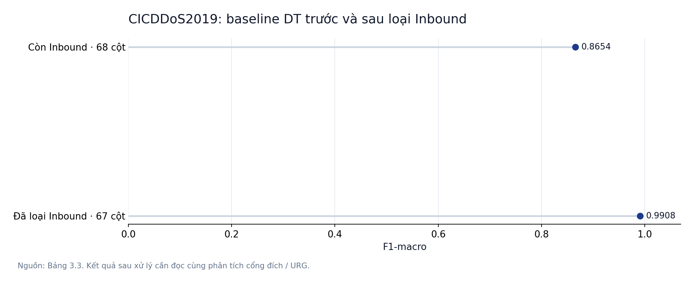

*Đối chiếu Bảng 3.3: F1 baseline DT tăng sau khi bỏ Inbound. Đây là phép đo trên dữ liệu báo cáo.*

Trên CICDDoS2019, `Inbound` chiếm 77,3% độ quan trọng trong hai tập cột đã chọn. Train có 99,9% Attack với Inbound = 1. Đây là dấu hiệu mô hình đang dựa vào hướng thu thập lưu lượng. Loại cột này làm baseline DT tăng từ 0,8654 lên 0,9908; báo cáo loại nó và chạy lại thực nghiệm.

Ngược lại, `Average Packet Size` có MI cao nhưng độ dài gói khác nhau theo loại giao thức là lời giải thích hợp lý, nên được giữ. Audit CICIDS2017 và UNSW cũng thấy các cột quan trọng nhưng bỏ chúng không làm F1 giảm đáng kể: `Bwd Packet Length Std` cho 0,9943 → 0,9943; `sttl` cho 0,8631 → 0,8656. Các phép thử này không phát hiện vấn đề tương tự Inbound; chúng chưa chứng minh dữ liệu hoàn toàn không có artifact.

**Vì sao xem độ quan trọng rồi còn phải ablation?** Độ quan trọng cho biết cây đã dùng cột nào nhiều; ablation hỏi nếu không có cột đó, mô hình có học được bằng các cột khác không. Hai câu hỏi khác nhau. Nếu bỏ cột mà F1 không giảm, tín hiệu có thể được thay thế; nếu giảm mạnh, ta biết mô hình phụ thuộc cột nhưng vẫn chưa biết cột đó hợp lệ hay artifact. Cần đọc ý nghĩa và phân bố cột cùng kết quả phép thử.

## 6. Tiền xử lý dữ liệu từng bước


*Từ gói tin đến bảng luồng: kiểm tra dữ liệu, chia train/test trước khi học tham số, xử lý thiếu và mã hóa. Đây là quy trình nên áp dụng; đối chiếu Mục 11 về mã hiện tại.*


Phần này giải thích mục đích các thao tác trong báo cáo và trình tự nên áp dụng để giữ test độc lập. Những khác biệt trong mã hiện tại được ghi riêng ở Mục 11.

### 6.1. Đọc CSV và chuẩn hóa tên cột

Đọc bảng, bỏ khoảng trắng đầu/cuối tên cột. Ví dụ `" Destination Port"` trở thành `"Destination Port"`, tránh xem cùng một cột là hai tên khác nhau.

**Vì sao thao tác nhỏ này cần làm trước?** Các lệnh chọn hoặc loại cột dùng tên chính xác. Nếu `Label` và ` Label` bị coi là khác nhau, chương trình có thể không tìm được nhãn hoặc không loại được cột cần loại. Chuẩn hóa tên giúp các bước sau thực hiện đúng cấu hình; sau đó vẫn phải kiểm tra có tên cột bị trùng sau khi bỏ khoảng trắng hay không.

### 6.2. Xác định các phần dữ liệu

Với UNSW và CICDDoS2019, dùng tệp train/test có sẵn. Với một tệp CICIDS2017, nguyên tắc đúng là xác định nhãn, chia phân tầng 80/20 trước khi học tham số tiền xử lý.

Giữ riêng nhãn `y` và đặc trưng `X`. Các nhãn hoặc cột định danh không được vô tình trở thành đầu vào.

**Vì sao chia trước mọi bước có học tham số?** Ngay cả bước không nhìn nhãn, như tìm trung vị hoặc loại cột gần hằng, vẫn học đặc điểm phân bố dữ liệu. Học nó trên cả test làm test tác động vào cách xây dựng mô hình. Với việc chia train thành phần fit và validation, nguyên tắc tương tự áp dụng trong từng lần đánh giá nghiêm ngặt. Các thao tác định trước không cần học, như bỏ khoảng trắng tên cột, khác với việc ước lượng tham số từ dữ liệu.

### 6.3. Xử lý giá trị thiếu và vô cực

Một phép tính như tốc độ trên thời lượng bằng 0 có thể tạo vô cực. Đổi vô cực thành giá trị thiếu `NaN`, rồi điền giá trị hợp lý.

Báo cáo dùng trung vị: sắp các giá trị và lấy giá trị giữa, ít bị kéo lệch bởi giá trị cực lớn hơn trung bình. Cách đúng là lưu trung vị từng cột của train và dùng chính các giá trị đó cho test. Không tính lại trung vị trên test.

**Vì sao không để nguyên NaN và vô cực?** Chúng có thể làm thuật toán lỗi hoặc khiến các phép tính không còn ý nghĩa. Ví dụ tốc độ bằng số byte chia thời lượng có thể thành vô cực nếu thời lượng bằng 0. Chuyển vô cực thành NaN cho phép đưa chúng vào cùng quy trình xử lý thiếu, nhưng vẫn cần kiểm tra nguyên nhân thay vì xem mọi vô cực là lỗi ngẫu nhiên.

**Vì sao dùng trung vị thay vì trung bình hoặc xóa hết dòng thiếu?** Với các giá trị 10, 12, 14, 16, 10.000, trung vị là 14 còn trung bình là 2.010,4. Dữ liệu mạng có giá trị rất lệch, nên trung vị ít bị một giá trị lớn kéo đi. Xóa mọi dòng thiếu lại có thể làm mất nhiều mẫu hoặc loại mất lớp hiếm. Điền trung vị cũng có nhược điểm: tạo nhiều giá trị giống nhau và không khôi phục được thông tin thật đã mất. Nếu một cột thiếu quá nhiều hoặc thiếu gắn với một lớp cụ thể thì cần phân tích riêng; không mặc định điền trung vị là luôn đúng.

### 6.4. Dòng trùng, cột gần hằng và cột định danh

Dòng trùng có thể làm một mẫu bị đếm nhiều lần. Cột gần hằng có rất ít biến thiên, thường ít giúp phân biệt lớp. Danh sách cột gần hằng cần được xác định trên train rồi áp dụng thống nhất.

Loại các cột như Flow ID, địa chỉ IP, cổng nguồn, Timestamp theo cấu hình CICDDoS2019 và `id` của UNSW. Các cột này có thể khiến mô hình ghi nhớ môi trường. `Destination Port` vẫn được giữ trong thực nghiệm, nhưng ảnh hưởng của nó được kiểm tra riêng. `Inbound` bị loại sau phân tích chất lượng dữ liệu.

**Vì sao dòng trùng có thể gây vấn đề?** Một mẫu lặp lại nhiều lần làm mô hình ưu tiên nó nhiều hơn. Nếu các bản sao nằm ở cả train và test, điểm có thể cao vì gặp lại dữ liệu gần như đã biết. Tuy nhiên, các luồng giống nhau có thể xuất hiện thật trong tấn công; loại trùng cũng làm thay đổi phân bố, nên cần ghi rõ quy tắc thay vì xóa chỉ vì thấy giống.

**Vì sao bỏ cột gần hằng?** Cột có cùng một giá trị ở mọi dòng train không giúp chia các dòng train thành nhóm khác nhau. Giữ nó tăng số chiều tìm kiếm mà không đem lại khả năng phân biệt trên train. “Gần hằng” cần cẩn thận hơn: biến thiên ít có thể liên quan lớp hiếm, và phương sai còn phụ thuộc đơn vị đo.

**Vì sao bỏ IP, ID hoặc Timestamp?** Mô hình có thể ghi nhớ máy nào hoặc đợt thu thập nào thường mang nhãn Attack, thay vì học hành vi có thể dùng ở môi trường khác. Không phải các cột này vô dụng trong mọi NIDS; việc loại chúng phụ thuộc mục tiêu tổng quát hóa của nghiên cứu. Cổng đích cũng cần xem xét tương tự, vì vừa có ý nghĩa dịch vụ vừa có thể gắn với cấu hình thí nghiệm.

### 6.5. Chuyển nhãn

Nhị phân: nhãn chứa `normal` hoặc `benign`, không phân biệt hoa thường, được xem là Normal; phần còn lại là Attack theo quy tắc của báo cáo. Phải đối chiếu quy tắc với tên nhãn thực của từng bộ dữ liệu.

Đa lớp: giữ tên nhóm tấn công, sau đó mã hóa thành số. Số 0, 1, 2 chỉ là mã; không mang ý nghĩa lớp nào “lớn hơn”. Nhãn chỉ có ở test được ánh xạ thành mã `Unknown` riêng, lưu trong `label_classes.json`. Ánh xạ này giúp chấm điểm rõ ràng, không tự tạo cho mô hình khả năng phát hiện Unknown.

**Vì sao cần quy tắc nhãn rõ ràng?** Tên lớp giữa các bộ dữ liệu khác nhau; chương trình không tự hiểu `Normal Traffic` đồng nghĩa bình thường nếu quy tắc viết sai. Sau ánh xạ phải kiểm tra số mẫu từng lớp với nhãn gốc. Với đa lớp, gán nhãn lạ thành Unknown giúp tránh âm thầm gọi chúng là một lớp đã biết, nhưng không dạy mô hình dự đoán Unknown. Muốn làm được điều đó cần thiết kế phát hiện loại chưa biết riêng.

### 6.6. Mã hóa cột phân loại

UNSW có `proto`, `service`, `state` dạng chữ. Label Encoding đổi mỗi giá trị thành một mã số, học ánh xạ từ train rồi áp dụng cho test. Ví dụ minh họa `tcp → 0`, `udp → 1`.

Các mã là quy ước, không có khoảng cách tự nhiên. Cây vẫn có thể tạo ngưỡng trên các mã này, nên cách mã hóa có thể ảnh hưởng kết quả. Đây là cách báo cáo sử dụng, không phải lựa chọn duy nhất cho dữ liệu phân loại.

**Vì sao chuyển chữ thành số?** Các bộ phân loại trong pipeline cần đầu vào số. Bộ mã hóa lưu quy ước để cùng một giao thức có cùng mã ở train và test. Nếu mã hóa hai tập riêng, `tcp` có thể thành 0 ở train nhưng 1 ở test, làm sai ý nghĩa đầu vào.

**Vì sao không hiểu các mã như độ lớn?** Nếu tcp=0, udp=1, icmp=2 thì icmp không “gấp đôi” udp. Đây chỉ là tên viết bằng số. One-hot encoding là một cách khác, tạo cột 0/1 cho từng giá trị nhưng làm tăng số chiều; báo cáo chọn Label Encoding, nên cần ghi nhận hạn chế về thứ tự mã. Giá trị chữ mới ở test cũng cần có quy tắc xử lý đã định trước, không fit lại bộ mã hóa trên test.

### 6.7. Chuẩn hóa MinMax

Với từng cột, phép biến đổi là `x_mới = (x − min_train) / (max_train − min_train)`, với cột hằng cần xử lý riêng. Giá trị train thường nằm trong [0, 1]; test có thể vượt khoảng này nếu vượt cực trị train và không bật cắt ngưỡng.

Mục đích là thống nhất thang đo. Các mô hình cây thường ít cần chuẩn hóa hơn các mô hình dựa vào khoảng cách, nhưng pipeline báo cáo vẫn dùng MinMax. Tham số phải học từ train.

**Vì sao cần nhắc lại min/max tại đúng bước này?** Đây là nơi pipeline thật sự đổi thang dữ liệu. Ví dụ train có thời lượng nhỏ nhất 10 và lớn nhất 50, giá trị 30 trở thành 0,50; test có giá trị 70 thì dùng cùng tham số và được 1,50. Cách tính và lý do tránh dùng test đã giải thích kỹ tại Mục 2.5.

Cột có số lớn không mặc nhiên quan trọng hơn. MinMax hữu ích cho thuật toán nhạy với thang đo, nhưng các mô hình cây của báo cáo thường không bắt buộc cần nó. Cực trị train rất lớn có thể nén hầu hết giá trị còn lại vào một khoảng hẹp; vì vậy chuẩn hóa không thay thế kiểm tra ngoại lệ và không bảo đảm tăng F1.

### 6.8. Lưu dữ liệu và tham số

Đầu ra tiền xử lý gồm `X_train`, `X_test`, `y_train`, `y_test`, danh sách cột, scaler và bộ mã hóa. Các phương án FS nhận cùng dữ liệu này để so sánh công bằng.

SMOTE là kỹ thuật sinh mẫu cho lớp ít dữ liệu. Dù xuất hiện trong quy ước dự án và mã hỗ trợ, bảng thiết lập của báo cáo không xác nhận SMOTE đã được bật cho các kết quả chính; không nên kể nó như một bước đã chạy. Nếu dùng, chỉ áp dụng trên phần huấn luyện.

**Vì sao không chỉ lưu mô hình cuối?** Khi có luồng mới, phải điền thiếu, mã hóa, chuẩn hóa và sắp cột đúng như lúc học. Thiếu các tham số này, cùng một mô hình có thể nhận đầu vào sai thang hoặc sai ý nghĩa mã. Lưu kèm tên cột và cấu hình giúp đánh giá lại mà không cần chạy lại tìm kiếm. Các tệp lớn và dữ liệu gốc vẫn phải tuân thủ `.gitignore`.

**Vì sao nếu dùng SMOTE thì phải làm sau chia và chỉ trên phần fit?** Mẫu tổng hợp được tạo từ các mẫu hiện có. Nếu tạo trước khi chia, mẫu ở phần đánh giá có thể liên quan trực tiếp đến dữ liệu huấn luyện, làm điểm lạc quan. Validation và test cần giữ phân bố quan sát ban đầu để đánh giá có ý nghĩa. Báo cáo không xác nhận SMOTE được bật cho các bảng kết quả chính.

## 7. Các phương pháp chọn đặc trưng hoạt động thế nào


*Hai luồng xử lý bảng đặc trưng mạng: Hybrid 1 tiền lọc rồi tìm kiếm; Hybrid 2 phối hợp MI và SHAP. Các giá trị và tên cột ví dụ trong tranh chỉ để minh họa, không phải số liệu của báo cáo.*

### 7.1. Full features làm baseline

Huấn luyện và đánh giá với toàn bộ `D` cột sau tiền xử lý. Đây là mốc để biết FS có ích hay không. Bảy phương án trong báo cáo gồm một baseline và sáu phương án FS.

**Vì sao baseline cũng phải dùng cùng bộ phân loại và dữ liệu?** Nếu full dùng DT nhưng tập giảm chiều dùng RF, chênh lệch có thể do mô hình thay vì FS. Đối chứng phù hợp là cùng dữ liệu, cùng quy trình, cùng bộ phân loại, thay số cột. Bước đổi bộ phân loại sau đó là một thí nghiệm riêng.

### 7.2. Filter bằng Mutual Information

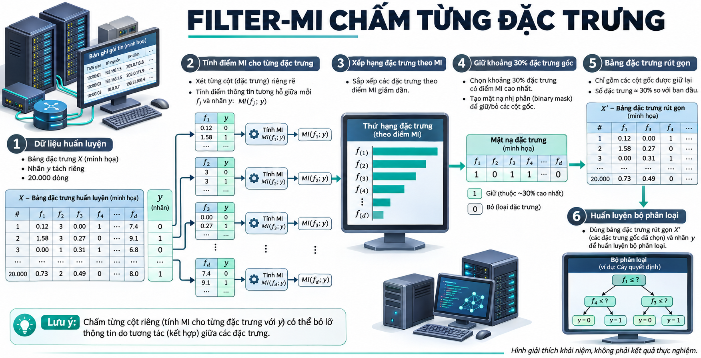

*MI chấm từng cột với nhãn rồi xếp hạng và giữ khoảng 30% số cột. Các ví dụ trong tranh không phải kết quả thực nghiệm.*


Lấy mẫu 20.000 dòng từ train, tính MI giữa mỗi cột và nhãn, sắp giảm dần rồi giữ khoảng 30% số cột. Số cột trong kết quả là 16/52, 13/42 và 20/67.

Ví dụ minh họa: ba cột A, B, C có MI lần lượt 0,30; 0,28; 0,05. Filter ưu tiên A và B. Nhưng A và B có thể chứa gần cùng thông tin, trong khi C có ích khi kết hợp với A. Chấm từng cột riêng không đánh giá đầy đủ sự phối hợp đó.

Ưu điểm là nhanh, dễ hiểu và không cần thử hàng trăm tập con. Hạn chế là phải chọn trước tỷ lệ giữ và có thể bỏ lỡ tương tác.

**Vì sao tính MI trên mẫu thay vì toàn bộ train?** Ước lượng MI với hàng triệu dòng có thể tốn thời gian; mẫu 20.000 dòng là lựa chọn giảm chi phí trong báo cáo. Lấy mẫu làm điểm xếp hạng có thể dao động hoặc thiếu đại diện của lớp hiếm. Con số 20.000 và tỷ lệ giữ 30% là cấu hình thực nghiệm, chưa được chứng minh tối ưu cho mọi dữ liệu.

**Vì sao MI có thể phát hiện điều tương quan bỏ lỡ?** Tương quan thông thường mô tả quan hệ tuyến tính, trong khi MI nhằm đo sự phụ thuộc rộng hơn. Tuy nhiên MI từng cột vẫn không đánh giá toàn bộ lợi ích của một tập cột khi dùng chung. Nếu hai cột cùng kể một thông tin, cả hai có thể được xếp cao mà không giúp nhiều khi kết hợp.

### 7.3. Wrapper và hàm fitness

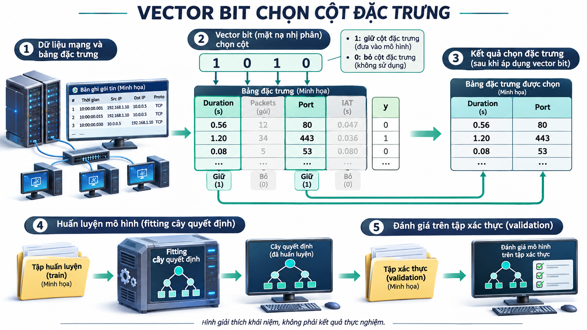

*Vector 1–0–1–0 giữ Duration và Port, bỏ Packets và IAT; nhãn y nằm riêng. Đây là ví dụ lựa chọn cột, không phải tập cột thực nghiệm.*


Wrapper thử một tập cột bằng cách huấn luyện mô hình rồi chấm trên validation. Với `D` cột có khoảng `2^D` tập con; 52 cột đã có khoảng 4,5 triệu tỷ tổ hợp, nên không thể thử hết.

GA và PSO dùng vector bit để biểu diễn lựa chọn. Ví dụ `[1, 0, 1, 0, 0]` nghĩa là giữ cột thứ nhất và thứ ba.

Fitness của GA/PSO trong báo cáo:

`fitness = 0,9 × F1_macro_validation − 0,1 × k/n`.

`n` là số cột trong không gian đang tìm, `k` là số được chọn. Phần đầu thưởng chất lượng, phần sau phạt tập quá lớn. Fitness là điểm tối ưu nội bộ, không phải F1 test. Ví dụ F1 validation 0,95 và giữ 10/50 cột cho fitness `0,9 × 0,95 − 0,1 × 0,2 = 0,835`.

Tính fitness dùng 5.000 dòng với CICIDS2017 và CICDDoS2019, toàn bộ train với UNSW; 30% dữ liệu dùng tìm kiếm làm validation. Vì đây chỉ là mẫu hoặc một lần chia, tập tối ưu trên validation có thể không tối ưu trên test.

**Vì sao phải có “mẫu fitness”?** Đây là dữ liệu lấy từ train để thử nhiều tập cột nhanh hơn. Với 5.000 dòng và tỷ lệ 70/30, khoảng 3.500 dòng dùng fit DT, 1.500 dòng dùng validation. Mỗi ứng viên chỉ thay tập cột, còn phần dữ liệu đánh giá nên giữ cố định để so công bằng. Mẫu này không phải một bộ dữ liệu thứ tư và không phải test cuối.

**Vì sao vừa thưởng F1 vừa phạt số cột?** Chỉ tối ưu F1 có thể giữ gần hết cột, không đạt mục tiêu giảm chiều. Chỉ tối thiểu số cột có thể chọn tập quá ít thông tin. Công thức fitness thể hiện mức đánh đổi đã chọn: ví dụ với n=50, tập A có F1=0,95 và 5 cột cho điểm 0,845; tập B có F1=0,96 và 10 cột cho 0,844. Công thức ưu tiên A dù F1 thấp hơn một chút. Hai trọng số 0,9 và 0,1 là quyết định thiết kế, không phải định luật.

**Vì sao dùng DT và cache?** Fitness cần được tính rất nhiều lần, nên DT giúp giảm chi phí so với các mô hình nhiều cây. Cache nhận diện vector cột đã thử để tái dùng điểm; điều này phù hợp khi dữ liệu, cách chia và cấu hình mô hình được giữ cố định. Đổi bộ phân loại hoặc cách chia thì phải tính lại điểm phù hợp.

### 7.4. GA từng bước

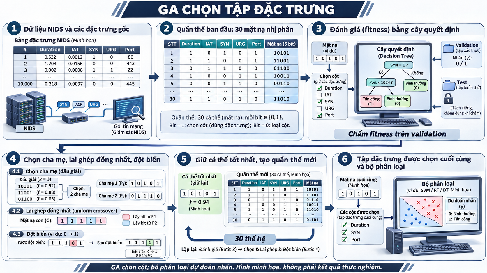

*Các cá thể là vector bit chọn cột. GA chấm chúng bằng Decision Tree trên validation, chọn cha mẹ, lai ghép, đột biến và giữ cá thể tốt. Test đứng ngoài quá trình tìm kiếm.*


GA, Genetic Algorithm, mô phỏng chọn lọc qua các thế hệ:

1. Tạo 30 vector bit ngẫu nhiên; mỗi bit có xác suất 0,5 được chọn.
2. Huấn luyện mô hình DT cho từng tập cột, tính fitness trên validation.
3. Chọn cha mẹ bằng tournament: lấy một nhóm 3 cá thể rồi ưu tiên cá thể tốt hơn.
4. Lai ghép đồng nhất với xác suất 0,8 để tạo các tổ hợp bit mới.
5. Đột biến: lật mỗi bit với xác suất `1/n`.
6. Giữ ít nhất một cá thể tốt nhất, gọi là elitism; lặp trong 30 thế hệ.
7. Lấy nghiệm tốt nhất; nếu vector không chọn cột nào thì sửa để có ít nhất một cột.

Chương trình lưu đệm kết quả của vector đã thử để tránh huấn luyện lại. GA không bảo đảm tìm được tối ưu toàn cục. Quần thể 30 và 30 thế hệ cũng không đồng nghĩa luôn có đúng 900 lần huấn luyện khác nhau vì có nghiệm lặp và cache.

**Vì sao GA cần các thao tác này?** Khởi tạo nhiều vector giúp xuất phát từ nhiều tập cột. Tournament thiên về nghiệm tốt nhưng vẫn để các nghiệm khác có cơ hội làm cha mẹ. Lai ghép thử kết hợp các lựa chọn của hai cha mẹ; tổ hợp tốt của từng bên chưa chắc tốt khi ghép, nên phải chấm lại. Đột biến cho phép bật lại cột đã mất hoặc bỏ cột đang giữ, tránh chỉ xoay quanh những tổ hợp ban đầu.

Elitism giữ lại nghiệm tốt để thế hệ sau không vô tình đánh mất nó. Sửa vector rỗng vì mô hình không thể học từ tập không có cột trong thiết kế này. Dừng sau 30 thế hệ giới hạn thời gian tính toán; đó là ngân sách thực nghiệm, không phải bằng chứng đã tìm hết hoặc tìm đúng tối ưu. Tăng quần thể hay số thế hệ có thể tốn thêm thời gian mà chưa chắc tăng F1 test.

### 7.5. PSO nhị phân từng bước


*Hạt mang vector chọn đặc trưng, ghi nhớ pbest và gbest, rồi cập nhật bit qua vận tốc và sigmoid. Không gian tọa độ chỉ là cách hình dung quá trình tìm kiếm.*


PSO giữ 30 hạt. Mỗi hạt có **vị trí** là vector chọn cột và **vận tốc** là các số thực điều khiển xác suất thay đổi. Hạt nhớ nghiệm tốt nhất của chính nó, `pbest`; cả bầy nhớ nghiệm tốt nhất chung, `gbest`.

Ở mỗi vòng, vận tốc kết hợp hướng di chuyển cũ, hướng về `pbest` và hướng về `gbest`. Hàm sigmoid `1 / (1 + exp(−v))` đổi vận tốc thành xác suất để lấy bit mới. Sau đó tính fitness và cập nhật các nghiệm tốt nhất.

Thiết lập: 30 vòng, trọng số quán tính giảm từ 0,7 xuống 0,4, hai hệ số học bằng 1,5, vận tốc giới hạn trong [−4, 4].

**Hội tụ sớm** là bầy mất đa dạng hoặc ngừng cải thiện quá sớm. Báo cáo quan sát best fitness không đổi ngay từ đầu và thêm hai cơ chế: mỗi vòng đột biến 15% số hạt với xác suất lật bit `3/n`; sau 5 vòng không cải thiện, khởi tạo lại 30% hạt kém nhất.

Trên CICIDS2017, fitness tăng từ 0,84381 lên 0,84829 ở vòng 6 và 0,84962 ở vòng 12; số cột giảm từ 22 xuống 14. Việc tìm kiếm có tiến triển hơn không bảo đảm F1 test cao hơn: báo cáo ghi F1 test thay từ 0,9981 xuống 0,9923.

**Vì sao PSO cần pbest và gbest?** pbest lưu kinh nghiệm tốt nhất từng hạt đã gặp; gbest chia sẻ nghiệm tốt nhất của bầy. Hai nguồn này hướng việc thử các vector mới. Vận tốc là trạng thái toán học điều khiển xác suất chọn bit, không phải tốc độ gói tin. Sigmoid đưa vận tốc thực về khoảng xác suất để có thể lấy quyết định 0/1.

**Vì sao giảm quán tính và giới hạn vận tốc?** Quán tính điều chỉnh mức giữ hướng cập nhật cũ. Giảm từ 0,7 xuống 0,4 là cách điều chỉnh ảnh hưởng đó theo vòng lặp trong báo cáo. Giới hạn vận tốc tránh sigmoid quá sát 0 hoặc 1 ở các giá trị rất lớn, khiến lựa chọn gần như cố định. Các tham số này là cấu hình đã thử, chưa có bằng chứng là tốt nhất.

**Vì sao đột biến và khởi tạo lại?** Khi nhiều hạt quanh cùng nghiệm, chúng có thể ngừng khám phá tập cột khác. Lật bit tạo thay đổi nhỏ; khởi tạo lại hạt kém tạo xuất phát mới xa hơn. Giữ phần còn lại giúp không xóa hết kinh nghiệm đã có. Có thay đổi trong fitness cho thấy tìm kiếm tiến triển, nhưng không chứng minh hội tụ sớm là nguyên nhân duy nhất của mọi lần đứng yên.

### 7.6. Hybrid 1 kết hợp MI với GA hoặc PSO


Trước tiên MI giữ 50% số cột. Sau đó GA hoặc PSO chỉ tìm trong phần đã giữ. Ví dụ từ 52 cột xuống khoảng 26 cột ứng viên, rồi tìm tập con trong 26 cột đó.

Fitness bổ sung F1 của lớp ít mẫu nhất trong train:

`fitness = 0,8 × F1_macro + 0,1 × F1_lớp_hiếm − w_feat × k/n`.

Trong đó `n` là số cột sau tiền lọc. Việc bổ sung một lớp hiếm không bảo đảm mọi lớp hiếm đều cải thiện. Nếu MI đã loại một cột cần thiết, wrapper sau đó không thể chọn lại cột ấy.

Báo cáo dùng `w_feat = 0,05` cho Hybrid 1-GA; Hybrid 1-PSO trên CICIDS2017 và UNSW dùng 0,1. Khi không gian giảm một nửa, cùng một cột bị phạt nhiều hơn nếu giữ nguyên hệ số, vì mẫu số `n` nhỏ hơn. Đây là lý do trọng số ảnh hưởng rõ đến số cột và F1.

**Vì sao tiền lọc giúp giảm chi phí?** Với D cột có khoảng 2^D tập con; giữ một nửa làm không gian nhỏ đi rất nhiều. Wrapper cũng huấn luyện trên ít cột hơn. Đổi lại, một cột có MI riêng thấp nhưng hữu ích khi kết hợp có thể bị loại vĩnh viễn. Tỷ lệ 50% là điểm đánh đổi thực nghiệm, không bảo đảm giữ mọi tín hiệu cần thiết.

**Vì sao thêm F1 lớp hiếm khi đã có F1-macro?** Macro đã đối xử ngang nhau với các lớp, nhưng tăng điểm ở nhiều lớp vẫn có thể che việc một lớp hiếm giảm điểm. Thành phần bổ sung tăng áp lực giữ chất lượng cho lớp ít mẫu nhất. Nó cũng làm mục tiêu phụ thuộc lựa chọn lớp và có thể nhạy với ước lượng từ ít mẫu; không bảo đảm cải thiện mọi lớp hiếm.

**Vì sao phải chú ý mẫu số n của mức phạt?** Với n=52, thêm một cột làm phần phạt tăng `w_feat/52`; sau lọc còn n=26, mức tăng là `w_feat/26`, gấp đôi nếu giữ cùng trọng số. Vì vậy cùng tên trọng số nhưng tác động thực tế khác giữa wrapper thuần và Hybrid 1.

### 7.7. Hybrid 2 kết hợp MI với SHAP từ XGBoost


XGBoost xây nhiều cây nối tiếp, mỗi cây bổ sung để giảm sai số của tập cây hiện tại. SHAP giải thích mức đóng góp của từng đặc trưng vào dự đoán của mô hình đó.

Quy trình Hybrid 2:

1. Tính MI trên mẫu 20.000 dòng train.
2. Huấn luyện XGBoost với 200 cây, độ sâu tối đa 6, và tính SHAP.
3. Lấy trung bình trị tuyệt đối SHAP của từng cột; với đa lớp, lấy qua các lớp.
4. Chuẩn hóa riêng điểm MI và điểm SHAP về [0, 1].
5. Tính `score = 0,5 × MI_chuẩn_hóa + 0,5 × SHAP_chuẩn_hóa`.
6. Giữ khoảng 30% cột điểm cao nhất.

Trị tuyệt đối giúp đo độ lớn đóng góp, không để các đóng góp dương và âm triệt tiêu. Điểm SHAP phụ thuộc mô hình đã học và không chứng minh quan hệ nhân quả. Hybrid 2 không dùng vòng tìm kiếm kiểu GA/PSO; dùng XGBoost để chọn cột cũng không bắt buộc bộ phân loại cuối phải là XGBoost.

**Vì sao cần cả MI và SHAP?** MI cung cấp cách nhìn từng cột gắn với nhãn; SHAP phản ánh đóng góp của cột trong mô hình XGBoost đã học. Phối hợp hai cách nhìn nhằm giảm phụ thuộc vào một cách xếp hạng, nhưng vẫn phải kiểm tra bằng đánh giá cuối, vì SHAP cũng phụ thuộc mô hình và dữ liệu học.

**Vì sao lấy trị tuyệt đối SHAP rồi trung bình?** Một cột có thể đẩy dự đoán lên ở mẫu này và xuống ở mẫu khác. Lấy trung bình có dấu có thể cho gần 0 dù cột tác động mạnh. Trị tuyệt đối đo độ lớn; trung bình qua mẫu cho độ quan trọng tổng quát theo tập đang xét. Với đa lớp, lấy qua các lớp để không chỉ ưu tiên cách giải thích một lớp.

**Vì sao chuẩn hóa điểm trước khi cộng?** MI và mean|SHAP| không cùng thang đo. Nếu cộng trực tiếp, loại điểm có giá trị số lớn hơn có thể chi phối dù đặt trọng số bằng nhau. Đổi riêng mỗi loại về [0,1] giúp trọng số 0,5/0,5 có ý nghĩa phối hợp rõ hơn. Nó không biến điểm thành xác suất, và bằng trọng số không có nghĩa hai nguồn thông tin chắc chắn đáng tin ngang nhau.

### 7.8. Các bộ phân loại cuối

**Decision Tree** là một cây các điều kiện chia dữ liệu. **Random Forest** kết hợp nhiều cây với dữ liệu và đặc trưng được ngẫu nhiên hóa. **XGBoost** kết hợp các cây học nối tiếp. Báo cáo dùng DT cho fitness để giảm chi phí, rồi đánh giá một số tập cột bằng RF 100 cây và XGBoost 200 cây.

`eval_selected.py` nhận tập cột đã chốt và đổi bộ phân loại cuối. Nó giúp kiểm tra cùng một tập cột phù hợp với các mô hình ra sao, không phải chạy lại GA để tối ưu riêng cho RF hoặc XGBoost.

**Vì sao tìm bằng DT nhưng đánh giá thêm RF và XGBoost?** DT giúp thử nhanh; hai mô hình nhiều cây giúp kiểm tra lợi ích của tập cột có bền khi thay cách học không. Dùng đúng cùng tập cột giúp cô lập ảnh hưởng bộ phân loại. Đây là đánh giá khả năng chuyển tập cột giữa mô hình, không phải so các tập đã tối ưu riêng cho từng mô hình.

## 8. Kết quả tổng quan nên nhớ trước

| Tình huống | Kết quả đáng chú ý | Cách hiểu |
|:---|:---|:---|
| CICIDS2017 nhị phân, DT | Filter 16/52 cột: F1 0,9978; full: 0,9975 | Giảm chiều mạnh, chênh lệch chất lượng rất nhỏ |
| CICIDS2017 nhị phân, DT | GA 5/52 cột: F1 0,9959 | Tập rất nhỏ vẫn giữ chất lượng cao |
| UNSW nhị phân, DT | Hybrid 1-PSO 7/42: 0,8658; full: 0,8553 | Một số tập con tốt hơn full trong lần chạy này |
| UNSW đa lớp, DT | Hybrid 1-GA 6/42: 0,5550; full: 0,4896 | Giảm chiều có thể có ích cho bài toán khó hơn |
| CICDDoS2019 nhị phân | Thứ hạng thay đổi khi đổi DT/RF/XGBoost | Không thể xếp hạng FS chỉ bằng một bộ phân loại |
| CICDDoS2019 đa lớp | 89,4% test thuộc nhãn chưa thấy ở train | Không phù hợp để xếp hạng FS theo cách học đa lớp thông thường này |

Các kết quả chính chỉ có một seed 42. Chênh lệch nhỏ là quan sát của lần chạy, chưa đủ để khẳng định ưu thế có ý nghĩa thống kê.

## 9. Kết quả chi tiết và cách diễn giải

### 9.1. CICIDS2017 nhị phân với Decision Tree

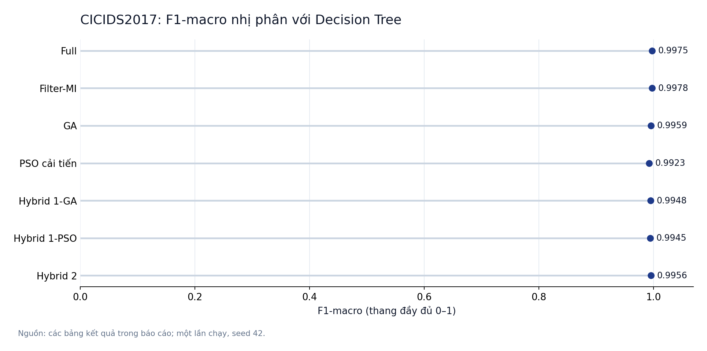

*So sánh F1-macro trên cùng thang 0–1. Chênh lệch nhỏ cần đọc giá trị ghi bên điểm.*

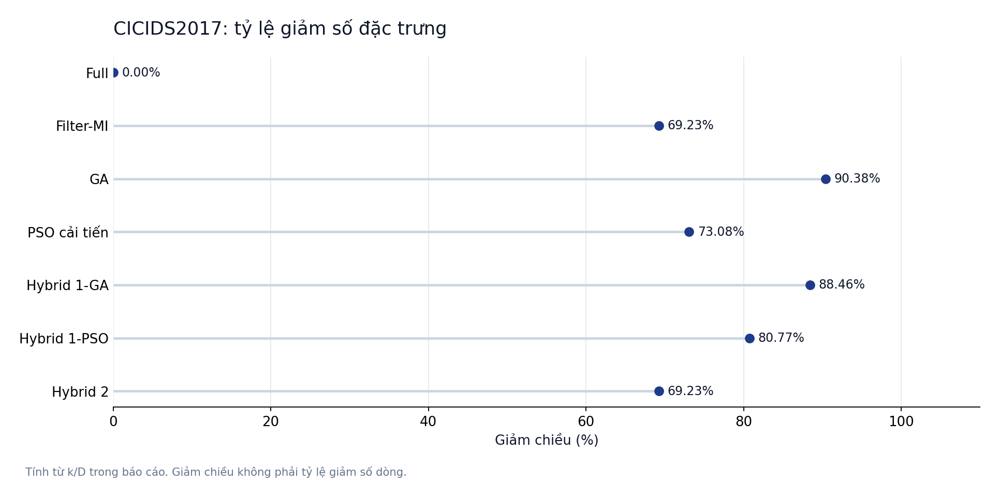

*Mức giảm số cột so với 52 đặc trưng đầu vào.*


*Thời gian train cuối, trục logarit; chưa cộng thời gian tìm tập cột.*

Nguồn: Bảng 3.5 của báo cáo. Cột giảm chiều được tính thêm từ k/D.

| Phương án | k/D | Giảm chiều % | F1-macro | Accuracy | T_train giây |
|:---|---:|---:|---:|---:|---:|
| Full | 52/52 | 0,00 | 0,9975 | 0,9986 | 150–195 |
| Filter-MI | 16/52 | 69,23 | 0,9978 | 0,9988 | 41,86 |
| GA | 5/52 | 90,38 | 0,9959 | 0,9977 | 8,09 |
| PSO cải tiến | 14/52 | 73,08 | 0,9923 | 0,9957 | 22,56 |
| Hybrid 1-GA | 6/52 | 88,46 | 0,9948 | 0,9971 | 12,34 |
| Hybrid 1-PSO | 10/52 | 80,77 | 0,9945 | 0,9969 | 47,77 |
| Hybrid 2 | 16/52 | 69,23 | 0,9956 | 0,9975 | 43,29 |

Filter tăng F1 0,03 điểm phần trăm, quá nhỏ để kết luận tốt hơn chắc chắn. GA giảm F1 0,16 điểm nhưng huấn luyện nhanh hơn khoảng 18,5–24,1 lần theo khoảng baseline. Đây là sự đánh đổi rõ giữa kích thước và chất lượng.

Thời gian tìm kiếm GA khoảng 26 giây; PSO khoảng 60–100 giây; Hybrid 1 khoảng 15–35 giây cộng khoảng 7 giây MI. Phải cộng các khoản này khi so sánh chi phí xây dựng mô hình một lần.

**Vì sao không gọi Filter là tốt nhất chắc chắn?** Chênh lệch F1 rất nhỏ và chỉ có một lần chạy. Số đo có thể thay đổi khi đổi seed, phép chia hoặc mẫu MI. Điểm mạnh rõ hơn trong bảng là lượng cột và chi phí train giảm; muốn xác nhận ưu thế chất lượng cần các lần lặp và khoảng bất định.

### 9.2. UNSW-NB15 nhị phân với Decision Tree

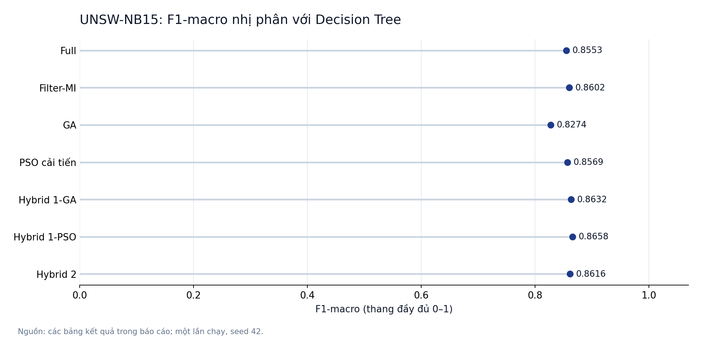

*F1-macro nhị phân: GA thuần chọn ít cột nhưng thấp hơn baseline.*

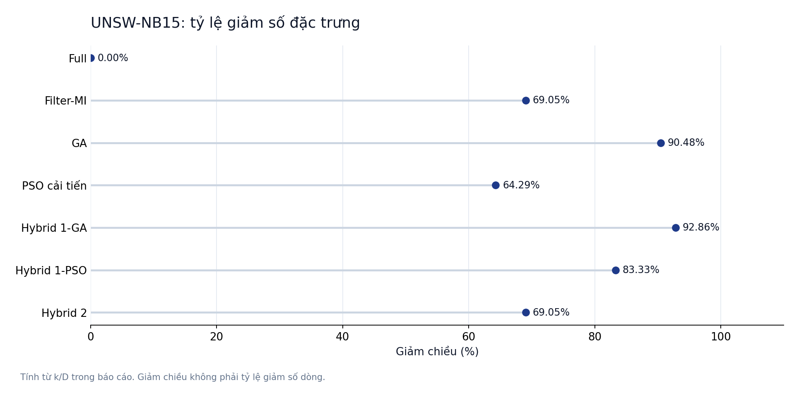

*Mức giảm số cột so với 42 đặc trưng đầu vào.*

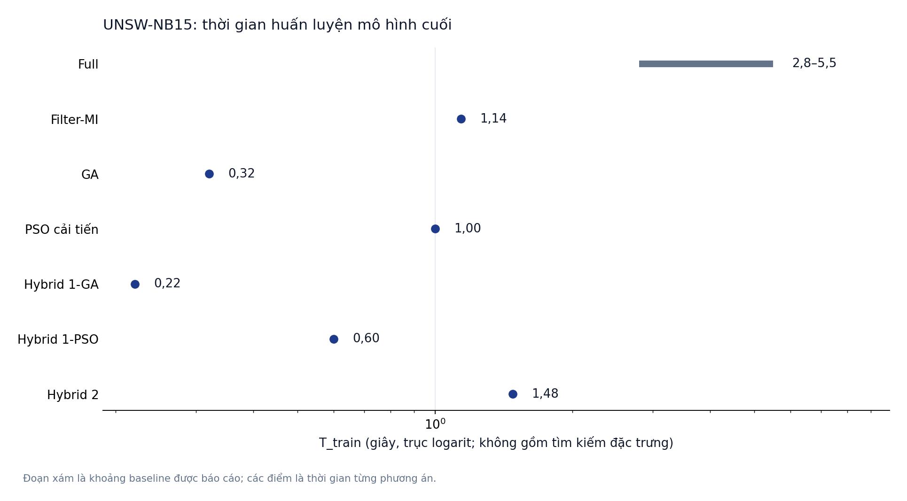

*Chi phí train cuối; chi phí wrapper tìm kiếm được giải thích ở phần chữ bên dưới.*


*Hai thiết lập trọng số phạt của Hybrid 1-GA và F1 tương ứng, từ Bảng 3.7.*

Nguồn: Bảng 3.6.

| Phương án | k/D | Giảm chiều % | F1-macro | Accuracy | T_train giây |
|:---|---:|---:|---:|---:|---:|
| Full | 42/42 | 0,00 | 0,8553 | 0,8605 | 2,8–5,5 |
| Filter-MI | 13/42 | 69,05 | 0,8602 | 0,8652 | 1,14 |
| GA | 4/42 | 90,48 | 0,8274 | 0,8354 | 0,32 |
| PSO cải tiến | 15/42 | 64,29 | 0,8569 | 0,8621 | 1,00 |
| Hybrid 1-GA | 3/42 | 92,86 | 0,8632 | 0,8684 | 0,22 |
| Hybrid 1-PSO | 7/42 | 83,33 | 0,8658 | 0,8704 | 0,60 |
| Hybrid 2 | 13/42 | 69,05 | 0,8616 | 0,8665 | 1,48 |

Năm trong sáu phương án FS vượt baseline về F1 trong lần chạy. Hybrid 1-PSO cao nhất, hơn full 1,05 điểm. GA thuần chọn ít cột nhưng thấp hơn full 2,79 điểm; “ít cột hơn” chưa đủ để xem là tốt hơn.

Tìm kiếm GA khoảng 435 giây, PSO 1.640–1.800 giây, Hybrid 1-PSO khoảng 620 giây. Chi phí tìm kiếm lớn hơn nhiều thời gian train cuối của bộ dữ liệu này.

Bảng 3.7 cho thấy ảnh hưởng trọng số phạt của Hybrid 1-GA:

| Bộ dữ liệu | w_feat | k/D | F1-macro |
|:---|---:|---:|---:|
| CICIDS2017 | 0,10 | 4/52 | 0,9865 |
| CICIDS2017 | 0,05 | 6/52 | 0,9948 |
| UNSW-NB15 | 0,10 | 2/42 | 0,8272 |
| UNSW-NB15 | 0,05 | 3/42 | 0,8632 |

Giảm phạt cho phép giữ thêm cột và cải thiện F1 ở hai phép thử này. Đây không phải bằng chứng rằng cứ giảm phạt là luôn tốt.

**Vì sao ít cột có thể tốt hơn đủ cột?** Bớt cột có thể giảm nhiễu, thay cấu trúc cây và giảm việc ghi nhớ các quan hệ riêng của train. Bảng cho thấy hiện tượng đó nhưng chưa xác định chính xác cơ chế nào gây ra ở từng phương án. GA 4 cột thấp điểm hơn cũng cho thấy giảm nhiều không tự động tốt.

### 9.3. CICDDoS2019 nhị phân với Decision Tree

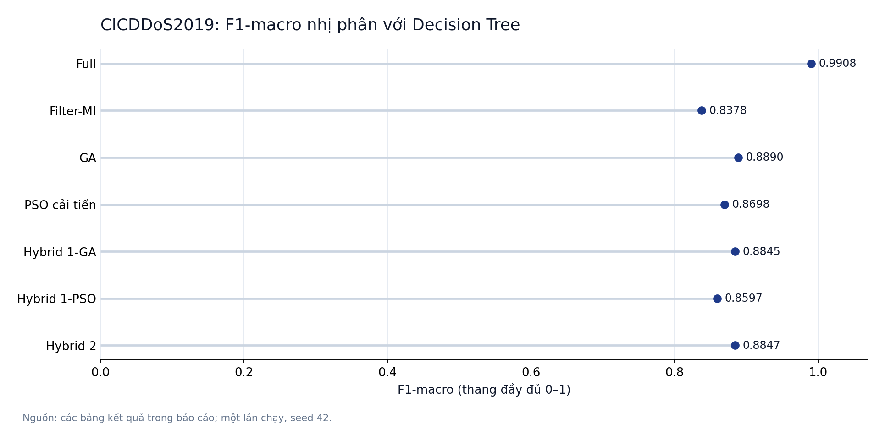

*Sau khi loại Inbound, full có F1 cao hơn các phương án FS với Decision Tree.*


*Mức giảm số cột so với 67 đặc trưng sau xử lý.*

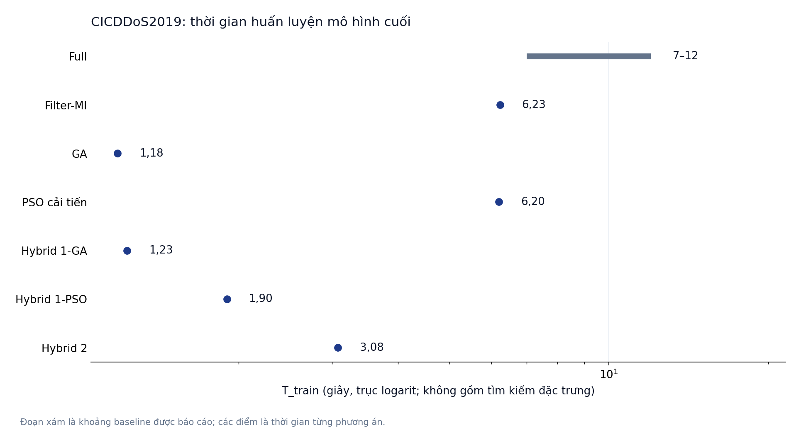

*Thời gian huấn luyện cần đọc cùng mức giảm F1, không chỉ nhìn tốc độ.*

Nguồn: Bảng 3.8, sau khi loại Inbound và chạy lại.

| Phương án | k/D | Giảm chiều % | F1-macro | Accuracy | T_train giây |
|:---|---:|---:|---:|---:|---:|
| Full | 67/67 | 0,00 | 0,9908 | 0,9966 | 7–12 |
| Filter-MI | 20/67 | 70,15 | 0,8378 | 0,9227 | 6,23 |
| GA | 6/67 | 91,04 | 0,8890 | 0,9518 | 1,18 |
| PSO cải tiến | 25/67 | 62,69 | 0,8698 | 0,9417 | 6,20 |
| Hybrid 1-GA | 4/67 | 94,03 | 0,8845 | 0,9499 | 1,23 |
| Hybrid 1-PSO | 10/67 | 85,07 | 0,8597 | 0,9360 | 1,90 |
| Hybrid 2 | 20/67 | 70,15 | 0,8847 | 0,9496 | 3,08 |

Mọi phương án FS thấp hơn full khoảng 10,18–15,30 điểm F1. Khác biệt lớn hơn hai bộ trước. Chỉ dựa vào bảng này, không thể khẳng định FS giữ chất lượng gần như nguyên vẹn trên cả ba bộ dữ liệu.

**Vì sao không dùng kết luận từ CICIDS2017 cho bộ này?** Train/test khác loại tấn công khiến tín hiệu có ích trên validation chưa chắc còn hữu ích ở test. Thêm vào đó, các cột đặc biệt và bộ phân loại làm điểm thay đổi mạnh. Cần đọc kết quả FS như một phần của bài toán tổng quát hóa, không chỉ xem số cột đã giảm.

### 9.4. Kết quả đa lớp


*Mỗi ô ghi giá trị chính xác. Accuracy gần 1 vẫn có thể đi cùng F1-macro thấp hơn rõ rệt.*


*Trên UNSW đa lớp, Hybrid 1-GA có F1-macro cao nhất trong lần chạy báo cáo.*

Nguồn: Bảng 3.9. Tất cả dùng Decision Tree; số cột được chọn có thể khác nhị phân vì nhãn và mục tiêu tìm kiếm thay đổi.

| Bộ dữ liệu | Phương án | k/D | F1-macro | Accuracy | T_train giây |
|:---|:---|---:|---:|---:|---:|
| CICIDS2017 | Full | 52/52 | 0,9673 | 0,9983 | 173–191 |
| CICIDS2017 | Filter-MI | 16/52 | 0,9583 | 0,9985 | 45,32 |
| CICIDS2017 | GA | 7/52 | 0,9194 | 0,9959 | 21,03 |
| CICIDS2017 | PSO | 21/52 | 0,9225 | 0,9971 | 59,22 |
| CICIDS2017 | Hybrid 1-GA | 7/52 | 0,8605 | 0,9971 | 21,59 |
| CICIDS2017 | Hybrid 1-PSO | 10/52 | 0,9557 | 0,9985 | 35,08 |
| CICIDS2017 | Hybrid 2 | 16/52 | 0,8762 | 0,9972 | 48,97 |
| UNSW-NB15 | Full | 42/42 | 0,4896 | 0,7325 | 3,5–4,0 |
| UNSW-NB15 | Filter-MI | 13/42 | 0,5117 | 0,7488 | 1,09 |
| UNSW-NB15 | GA | 9/42 | 0,5346 | 0,7536 | 0,42 |
| UNSW-NB15 | PSO | 19/42 | 0,4951 | 0,7411 | 1,59 |
| UNSW-NB15 | Hybrid 1-GA | 6/42 | 0,5550 | 0,7695 | 0,33 |
| UNSW-NB15 | Hybrid 1-PSO | 9/42 | 0,4845 | 0,7454 | 0,42 |
| UNSW-NB15 | Hybrid 2 | 13/42 | 0,4859 | 0,7374 | 0,87 |

Trên CICIDS2017, Hybrid 1-GA vẫn có Accuracy 99,71% nhưng F1-macro chỉ 86,05%. Điều đó cho thấy Accuracy cao có thể che khuất việc nhận biết kém các lớp nhỏ. Filter và Hybrid 1-PSO gần full hơn các phương án còn lại.

Trên UNSW, Hybrid 1-GA đạt 0,5550, cao hơn full 6,54 điểm, với 6/42 cột, giảm 85,71% số chiều. Cách giải thích “giảm nhiễu giúp lớp hiếm” là giả thuyết hợp lý của báo cáo, chưa được chứng minh bằng phân tích từng lớp hay thí nghiệm nhân quả.

Trên CICDDoS2019, có 501.372/561.000 mẫu test, khoảng 89,4%, thuộc nhãn chưa có ở train. F1-macro các phương án chỉ khoảng 0,084–0,116; full là 0,1010. Không dùng các số này để kết luận phương pháp FS nào tốt nhất. Mã Unknown là cách biểu diễn nhãn khi chấm điểm, không phải một lớp mà mô hình đã được huấn luyện để nhận biết.

**Vì sao cần chạy lại lựa chọn cột cho đa lớp?** Gom nhiều loại tấn công thành Attack có thể làm mất nhu cầu phân biệt giữa chúng. Một cột không cần để tách Normal/Attack vẫn có thể cần để tách hai loại tấn công. Vì vậy tập tối ưu theo nhãn nhị phân không mặc nhiên tối ưu theo nhãn đa lớp.

### 9.5. Đổi bộ phân loại trên cùng tập cột

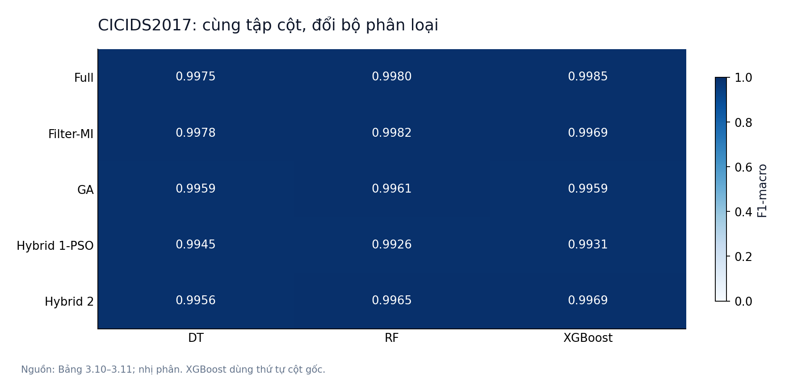

*CICIDS2017: các ô cùng tập cột nhưng khác bộ phân loại.*


*UNSW-NB15: so sánh F1 giữa DT, RF và XGBoost.*

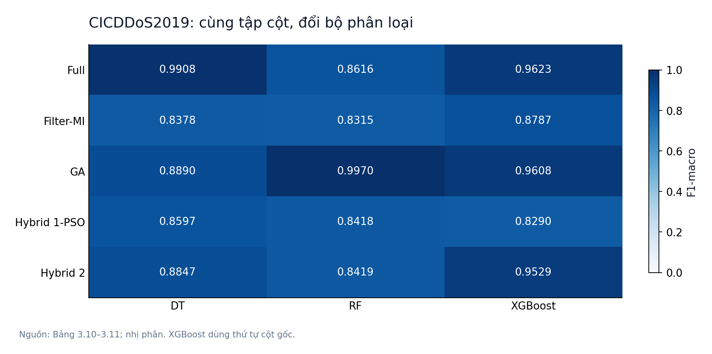

*CICDDoS2019: thứ hạng thay đổi mạnh theo bộ phân loại.*


*Cùng 10 cột Hybrid 1-PSO nhưng đổi thứ tự đầu vào của XGBoost.*

Nguồn: Bảng 3.10–3.11. Dưới đây là F1-macro nhị phân; các tập cột được giữ nguyên khi đổi mô hình.

| Bộ dữ liệu | Phương án | k/D | DT | RF | XGBoost |
|:---|:---|---:|---:|---:|---:|
| CICIDS2017 | Full | 52/52 | 0,9975 | 0,9980 | 0,9985 |
| CICIDS2017 | Filter-MI | 16/52 | 0,9978 | 0,9982 | 0,9969 |
| CICIDS2017 | GA | 5/52 | 0,9959 | 0,9961 | 0,9959 |
| CICIDS2017 | Hybrid 1-PSO | 10/52 | 0,9945 | 0,9926 | 0,9931 |
| CICIDS2017 | Hybrid 2 | 16/52 | 0,9956 | 0,9965 | 0,9969 |
| UNSW-NB15 | Full | 42/42 | 0,8553 | 0,8636 | 0,8624 |
| UNSW-NB15 | Filter-MI | 13/42 | 0,8602 | 0,8613 | 0,8651 |
| UNSW-NB15 | GA | 4/42 | 0,8274 | 0,8281 | 0,8241 |
| UNSW-NB15 | Hybrid 1-PSO | 7/42 | 0,8658 | 0,8655 | 0,8652 |
| UNSW-NB15 | Hybrid 2 | 13/42 | 0,8616 | 0,8677 | 0,8677 |
| CICDDoS2019 | Full | 67/67 | 0,9908 | 0,8616 | 0,9623 |
| CICDDoS2019 | Filter-MI | 20/67 | 0,8378 | 0,8315 | 0,8787 |
| CICDDoS2019 | GA | 6/67 | 0,8890 | 0,9970 | 0,9608 |
| CICDDoS2019 | Hybrid 1-PSO | 10/67 | 0,8597 | 0,8418 | 0,8290 |
| CICDDoS2019 | Hybrid 2 | 20/67 | 0,8847 | 0,8419 | 0,9529 |

Trên CICDDoS2019, RF với 6 cột GA đạt 0,9970, trong khi RF đủ 67 cột chỉ 0,8616. DT lại có full tốt hơn GA. Vì vậy một tập cột không có chất lượng độc lập hoàn toàn với bộ phân loại.

Tập GA 6 cột gồm `Destination Port`, `Bwd Packet Length Std`, `Fwd Packets/s`, `Packet Length Std`, `SYN Flag Count`, `URG Flag Count`.

XGBoost trên CICDDoS2019 còn nhạy với thứ tự cột. Cùng tập Hybrid 1-PSO: thứ tự JSON đạt 0,8614, thứ tự gốc đạt 0,8290, đảo ngược đạt 0,8279. Báo cáo quan sát kết quả lặp lại ổn định theo từng thứ tự và đưa giả thuyết về xử lý các điểm chia ngang độ lợi. Cơ chế đó chưa được kiểm chứng. Bảng trên dùng thứ tự cột gốc.

**Vì sao giữ cả tập cột và thứ tự cột khi so mô hình?** Thay tập cột làm đầu vào khác; thay thứ tự có thể làm cách xử lý các lựa chọn ngang điểm khác trong một số triển khai. Muốn biết chênh lệch do bộ phân loại, cần kiểm soát các yếu tố đầu vào này. Đặc biệt khi suy luận bằng một mô hình đã fit, đảo cột mà không sắp lại đúng có thể khiến mô hình đọc sai đặc trưng.

### 9.6. Bỏ từng đặc trưng để kiểm tra CICDDoS2019

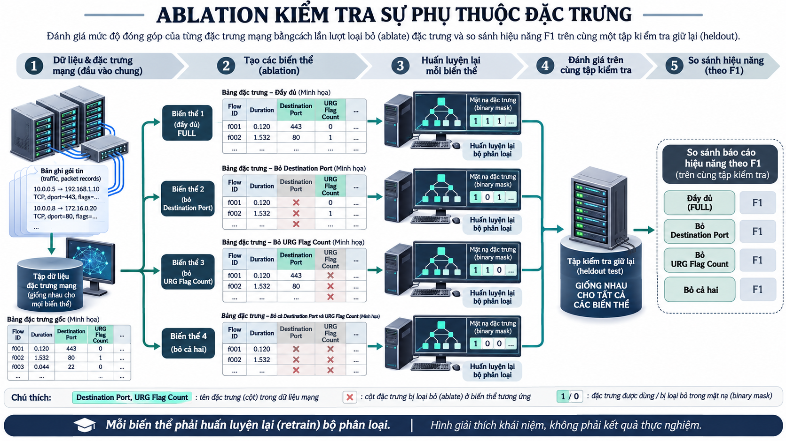

*Mỗi biến thể bỏ cột được huấn luyện lại, rồi đánh giá trên cùng test. Đọc số F1 thực tế ở biểu đồ và bảng bên dưới.*


*Số liệu Bảng 3.12: tác động của bỏ Destination Port và URG Flag Count.*

Nguồn: Bảng 3.12. Tất cả bắt đầu từ full 67 cột, XGBoost ở bảng dưới dùng thứ tự gốc.

| Biến thể | k | F1 DT | F1 RF | F1 XGBoost |
|:---|---:|---:|---:|---:|
| Đủ cột | 67 | 0,9908 | 0,8616 | 0,9623 |
| Bỏ Destination Port | 66 | 0,8550 | 0,8586 | 0,8172 |
| Bỏ URG Flag Count | 66 | 0,8008 | 0,8383 | 0,8441 |
| Bỏ cả hai | 65 | 0,8695 | 0,8462 | 0,8042 |

DT và XGBoost phụ thuộc mạnh vào cặp cột này. Bỏ cả hai không nhất thiết làm điểm giảm nhiều hơn bỏ một, vì mô hình được huấn luyện lại và có thể đổi cấu trúc cây.

XGBoost qua 5 thứ tự cột có F1 trung bình ± độ lệch chuẩn lần lượt: full `0,9570 ± 0,0093`; bỏ cổng đích `0,8160 ± 0,0010`; bỏ URG `0,8430 ± 0,0022`; bỏ cả hai `0,8068 ± 0,0037`. Đây là biến thiên theo thứ tự cột, không phải kết quả nhiều seed cho toàn bộ nghiên cứu.

**Vì sao bỏ từng cột rồi bỏ cả hai?** Bỏ riêng đo mức phụ thuộc khi cột còn lại vẫn có mặt; bỏ cả hai kiểm tra khả năng thay thế bằng các cột khác. Các mức giảm không cộng đơn giản vì mỗi cây được học lại từ đầu và có thể đổi các nhánh. Thử thêm thứ tự cột của XGBoost giúp xem mức giảm có còn lớn hơn biến thiên do thứ tự hay không.

### 9.7. Thêm cột còn thiếu vào các tập yếu

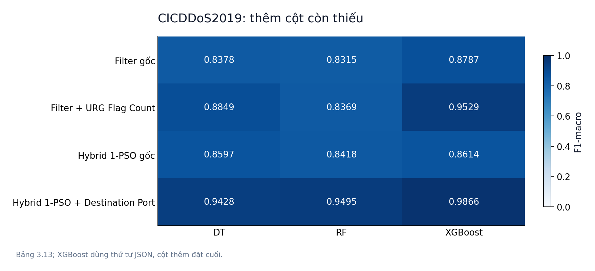

*Số liệu Bảng 3.13: thêm một cột có thể cải thiện mạnh F1. XGBoost dùng thứ tự JSON.*

Nguồn: Bảng 3.13. XGBoost dùng thứ tự JSON, cột thêm vào được đặt cuối; chỉ so sánh trong bảng này để tránh lẫn ảnh hưởng thứ tự.

| Tập cột | k | F1 DT | F1 RF | F1 XGBoost |
|:---|---:|---:|---:|---:|
| Filter gốc | 20 | 0,8378 | 0,8315 | 0,8787 |
| Filter + URG Flag Count | 21 | 0,8849 | 0,8369 | 0,9529 |
| Hybrid 1-PSO gốc | 10 | 0,8597 | 0,8418 | 0,8614 |
| Hybrid 1-PSO + Destination Port | 11 | 0,9428 | 0,9495 | 0,9866 |

Thêm cổng đích cho Hybrid 1-PSO cải thiện cả ba mô hình. Báo cáo nghi ngờ cổng đích phản ánh cấu hình thí nghiệm. URG bằng 0 ở 99,95% Attack train và 99,93% Attack test, so với 50,2% và 57,5% ở Normal. Đây là tín hiệu phân biệt mạnh, nhưng giải thích nó bằng hành vi flood vẫn là giả thuyết.

Không nên suy ra rằng hai cột này đủ để có mô hình tốt trong mọi mạng. Ngay trong thực nghiệm, có cả hai cột vẫn chưa bảo đảm điểm cao ở mọi tập cột và mọi bộ phân loại.

**Vì sao còn phải thử thêm cột sau khi đã thử bỏ?** Bỏ khỏi full cho biết cột có ích trong bối cảnh nhiều đặc trưng; thêm vào tập yếu hỏi nó có giúp ngay trong bối cảnh tập con đó không. Tác động của một cột phụ thuộc các cột đi cùng và mô hình dùng. Nếu điểm tăng mạnh, cần kiểm tra tín hiệu hợp lệ ở môi trường mới hay chỉ phản ánh cấu hình thu thập.

## 10. Đọc các tệp trong dự án để hiểu pipeline

| Tệp hoặc thư mục | Vai trò | Cần nhìn gì |
|:---|:---|:---|
| `preprocessing.py` | Đọc, làm sạch, mã hóa, chuẩn hóa, chia dữ liệu | Nhánh có test riêng và nhánh một tệp |
| `eda.py` | Khảo sát dữ liệu | Phân bố nhãn, MI, tương quan, PCA |
| `audit_feature_artifacts.py` | Kiểm tra cột đáng ngờ | Độ quan trọng và F1 trước/sau ablation |
| `filter_fs.py` | Chọn theo điểm từng cột | Cách tính MI và số cột giữ |
| `feature_selection.py` | GA, PSO và đánh giá | Dữ liệu fitness, vector bit, cache, lịch sử hội tụ |
| `hybrid1_fs.py` | MI rồi GA/PSO | Tỷ lệ tiền lọc, trọng số phạt và lớp hiếm |
| `hybrid2_fs.py` | MI cộng SHAP | Chuẩn hóa hai điểm, xử lý đa lớp |
| `eval_selected.py` | Đổi bộ phân loại cuối | Giữ nguyên tập cột và thứ tự cột |
| `ablation_full.py` | Bỏ cột khỏi full | Đo mức phụ thuộc vào các cột |
| `output/<dataset>/` | Dữ liệu đã xử lý và kết quả | `selected_features.json`, baseline, convergence |
| `eda_output/` | Báo cáo và hình EDA | Giải thích chất lượng dữ liệu trước khi nhìn điểm |

Một `selected_features.json` trả lời tập cột đã chọn là gì và các độ đo được lưu ra sao. `baseline_full_features.json` là mốc đối chứng. `convergence.csv/png` mô tả tiến triển fitness trong tìm kiếm; đường này không phải F1 test qua từng vòng.

Khi đọc một kết quả, lần lượt xác định dataset, chế độ nhãn, dữ liệu đã loại Inbound chưa, phương pháp chọn, bộ phân loại fitness, bộ phân loại cuối, số cột, F1 và loại thời gian đang báo cáo. Với XGBoost trên CICDDoS2019, kiểm tra thêm thứ tự cột.

## 11. Các điểm cần phân biệt giữa báo cáo, nguyên tắc và mã hiện tại

### 11.1. Tiền xử lý trước khi chia dữ liệu trong nhánh một tệp

Trong `preprocessing.py`, hàm `run()` ở nhánh không có `test_path` gọi `fit_transform()` trên toàn bộ dữ liệu rồi mới `train_test_split()`. Như vậy scaler, bộ mã hóa và việc loại cột gần hằng đã nhìn dữ liệu sau này thuộc test. Đây là điểm không đáp ứng quy tắc không rò rỉ trong `AGENTS.md`.

Trình tự cần có là chia dữ liệu thô trước, fit tiền xử lý trên train, transform test. Tài liệu này chỉ giải thích và ghi nhận; các số đã trích từ Word chưa được chạy lại bằng quy trình sửa đổi. Chưa có bằng chứng để định lượng ảnh hưởng của vấn đề này lên từng điểm số.

### 11.2. Điền thiếu trên test chưa tái dùng trung vị train

`clean_missing_and_infinite()` tính trung vị ngay trên bảng nhận vào. Hàm này được gọi trong cả `fit_transform()` và `transform()`, nên nếu test có thiếu, nó dùng trung vị test thay vì trung vị train đã lưu. Hàm còn có bước điền tiến/lùi. Vì vậy không thể mô tả mã hiện tại như một bộ điền thiếu đã fit hoàn toàn trên train.

### 11.3. Phân tầng và lấy mẫu

`_safe_stratified_split()` trong `feature_selection.py` thử chia phân tầng rồi chuyển sang `stratify=None` khi gặp lớp quá hiếm. Báo cáo cũng mô tả hành vi này ở phần đa lớp. Nó trái yêu cầu bắt buộc phân tầng của dự án. Cách xử lý phù hợp cần giữ đủ mẫu từng lớp hoặc điều chỉnh thiết kế đánh giá, thay vì âm thầm bỏ phân tầng.

Các hàm lấy mẫu MI/SHAP trong `filter_fs.py` và `hybrid2_fs.py` sử dụng `X.sample(...)`; mẫu ngẫu nhiên đó không bảo đảm giữ lớp hiếm. Khi đọc kết quả đa lớp, cần nhớ mẫu tính độ quan trọng có thể không đại diện đầy đủ các lớp.

### 11.4. Môi trường chạy được mô tả không thống nhất

Mục môi trường triển khai trong Word ghi Windows, PowerShell, Python 3.13; mục cấu hình ngay sau đó ghi Apple M1 Pro, macOS, Python 3.12 Miniconda. Từ văn bản này chưa xác định chắc bảng nào được đo trên cấu hình nào. Vì vậy dùng thời gian như số liệu mô tả của báo cáo và tránh suy rộng tốc độ tuyệt đối sang máy khác.

### 11.5. Các giới hạn còn lại

Một seed chưa cho biết độ ổn định. Ngưỡng chênh lệch khoảng 0,5 điểm mà báo cáo sử dụng là quy ước diễn giải, không thay thế kiểm định thống kê. Các giải thích về hành vi URG, RF bỏ lỡ tương tác hoặc PSO mắc cực trị cục bộ đều cần thí nghiệm thêm.

Audit và ablation đã tham khảo kết quả test trong quá trình phát triển. Để xác nhận khả năng tổng quát hóa sau các quyết định đó, cần một tập đánh giá độc lập mới, tốt hơn nữa là khác thời gian hoặc môi trường thu thập.

Báo cáo chưa đánh giá đầy đủ FAR/FPR, ROC, độ trễ phát hiện trực tiếp và hoạt động thời gian thực. Thời gian suy luận trên bảng đặc trưng cũng chưa bao gồm chi phí bắt gói và tạo đặc trưng. Vì vậy các kết quả hiện tại chủ yếu chứng minh quy trình thực nghiệm trên dữ liệu có sẵn.

## 12. Tự kiểm tra xem đã hiểu báo cáo chưa

**Vì sao phải có baseline?** Để biết tập con tốt đến đâu so với việc dùng đầy đủ thông tin, chứ không chỉ so các thuật toán với nhau.

**Vì sao không chọn cột bằng test?** Vì test phải mô phỏng dữ liệu chưa thấy; dùng nó để chọn cột làm đánh giá lạc quan.

**GA/PSO có trực tiếp dự đoán Attack không?** Chúng chọn tập cột; bộ phân loại DT, RF hoặc XGBoost mới tạo dự đoán.

**Vì sao F1 fitness và F1 test khác nhau?** Chúng dùng các phần dữ liệu khác nhau, và fitness còn trừ phạt số cột hoặc cộng F1 lớp hiếm.

**Vì sao Hybrid 1 và Hybrid 2 khác nhau?** Hybrid 1 tiền lọc rồi tìm tập con bằng wrapper; Hybrid 2 phối hợp hai loại điểm để xếp hạng cột.

**Vì sao Accuracy đa lớp rất cao mà F1-macro thấp?** Lớp nhiều mẫu có thể được dự đoán tốt trong khi các lớp nhỏ bị bỏ sót.

**Vì sao bỏ một cột lại tăng điểm?** Mô hình có thể ngừng dựa vào một tín hiệu gây nhiễu hoặc không ổn định giữa train và test.

**Vì sao không kết luận GA tốt nhất từ RF 0,9970 trên CICDDoS2019?** Cùng tập cột đó với DT chỉ 0,8890, và tín hiệu còn phụ thuộc cổng đích/URG trong môi trường dữ liệu này.

**Đóng góp chính nên trình bày là gì?** Quy trình so sánh nhiều họ FS, hai cách lai, cơ chế duy trì đa dạng cho PSO, và phân tích chất lượng dữ liệu để giải thích kết quả. Mức độ hiệu quả cần luôn gắn với dataset, chế độ nhãn, bộ phân loại và các giới hạn đã nêu.
